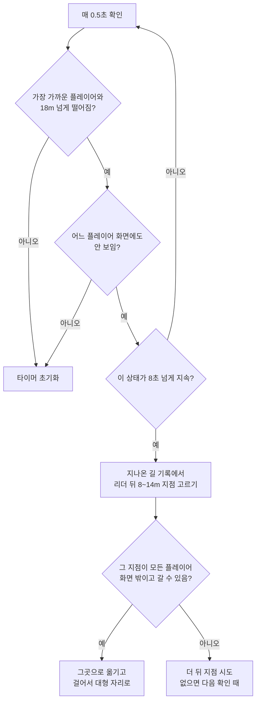
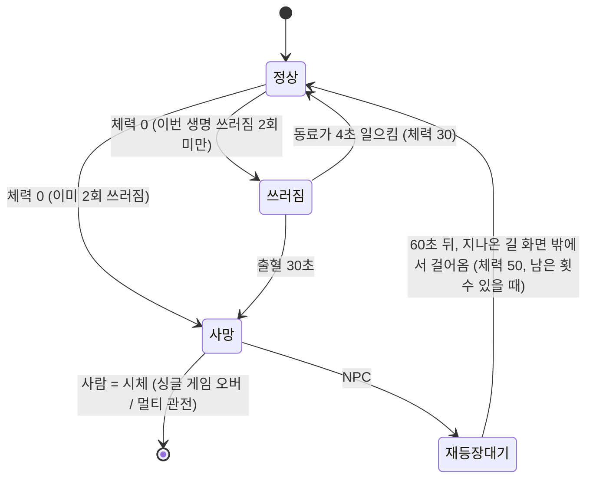

# AI 분대원 · 쓰러짐/부활 설계

> **상태**: 2026-10-20 구현(1~5단계). 결정은 `decisions.md` M-12~M-18. 구현하며 바뀐 점은 9장에 있습니다.
> **코드**: `game/scripts/Squad/`(두뇌·데이터), `game/scripts/Player/PlayerDowned.cs`(쓰러짐·일으키기), `Stage.cs`(분대 생성·전멸·재등장). **검사**: `game/tests/SquadCheck.tscn`.
> **범위**: 싱글 플레이의 AI 분대원(없음 / 1명 기본 / 3명, M-11)과, 싱글·멀티 공통의 "부활" 게임 옵션.
> 멀티에는 AI가 없습니다. 다만 부활 규칙은 멀티에서도 그대로 씁니다.

---

## 1. 원칙 (사용자 결정)

| # | 결정 | 내용 |
|---|---|---|
| 1 | **완전 자동, 보조 역할** | 명령 없음. AI는 어디까지나 돕는 역할이며 플레이어의 역할을 넘지 않음 |
| 2 | **아이템** | 탄약 더미와 구급상자만 주움. 투척물은 쓰지 않음 |
| 3 | **무기** | 시작 무기는 **NPC 무기 풀**(데이터)에서 랜덤. 전체 무기가 아니라 풀에 적힌 것만 |
| 4 | **따라잡기 순간이동** | 주변에 플레이어가 없을 때만. 멀어졌다고 바로 하지 않고, 일정 시간 따라오지 못할 때만. 플레이어 화면 밖, **이미 지나온 길** 쪽 가까이로 옮겨 원래 거기 있던 것처럼 걸어 들어옴 |
| 5 | **죽음** | 시체로 남음 (부활 옵션이 꺼져 있을 때) |
| 6 | **진행 방향** | 전투 중에는 적을 쫓아 플레이어 앞으로 갈 수 있음. 하지만 평소 진행에서 **플레이어보다 먼저 앞서가지 않음** |
| 7 | **부활 옵션** | 게임 옵션 "부활"을 켜면 쓰러진 동료를 일으킬 수 있음. NPC는 죽어도 자동으로 돌아옴(화면 밖, 지나온 쪽에서 걸어옴) |

"보조 역할"을 지키는 장치 (제안):
- AI는 **목표 상호작용을 하지 않습니다**: 문 열기, 셔터, 세이프하우스 닫기, 무기 줍기.
- AI의 공격력은 플레이어의 **70%**(데이터로 조정)이고 치명타는 없습니다.
- 앞서가지 않기(6번), 투척물 쓰지 않기(2번)도 같은 목적입니다.

---

## 2. 행동 우선순위

L4D식 **우선순위 목록**입니다. 위에서부터 조건이 맞는 첫 행동을 합니다. 0.2초마다 다시 판단하고, 이동은 매 프레임 합니다.

| 순서 | 행동 | 조건 · 내용 |
|---|---|---|
| 1 | 위험 피하기 | 불바다·황소 돌진 경로·불붙은 드럼통 반경 안이면 밖으로 이동 |
| 2 | **구출** | 붙잡힌 동료(끌개·덮치는 적)가 있으면 그 적을 공격해 풀어 줌 |
| 3 | 일으키기 | (부활 켬) 쓰러진 동료에게 가서 일으킴 |
| 4 | 치료 | 내 체력 40% 이하이고 6m 안에 적이 없으면 구급상자 사용 |
| 5 | 교전 | 대상 점수: 동료를 공격 중인 적 > 특수 감염체 > 가까운 적. 벽 너머와 사거리 밖은 제외. 사선에 동료가 있으면 쏘지 않고 옆으로 이동 |
| 6 | 줍기 | 탄약이 30% 이하이거나 구급상자가 없을 때, 8m 안이고 진행 방향 뒤쪽이 아니면 |
| 7 | 따라가기 | 대형 자리로 이동(3장). 멀면 달림. 따라잡기 순간이동(4장) |
| 8 | 경계 | 서로 다른 방향(앞·좌·우·뒤)을 바라봄 |

**조작은 사람과 같은 입력 함수로 합니다**(`SetControls`, `PressReload`, `PressHeal`…). 그래서 나중에 네트워크 파티원도 같은 자리에 끼울 수 있습니다.

---

## 3. 이동 · 대형 · 진행 방향

- **대형 자리**: 리더(가장 가까운 사람 플레이어) 기준으로 1번은 왼쪽 뒤, 2번은 오른쪽 뒤, 3번은 바로 뒤. 2~3.5m 거리이고 역할(5장)마다 조금 다릅니다.
- **길찾기**: 좀비가 쓰는 흐름장(flow field) 계산을 리더 위치를 목표로 재사용합니다. 군중 분리로 서로 겹치지 않게 합니다.
- **진행도**: 스테이지 출구까지의 흐름장 거리로 잽니다. 값이 작을수록 앞쪽입니다.
  - 평소: AI의 목표 지점은 리더보다 **앞서지 않게**(진행도 기준 리더 −0.5m까지) 자릅니다.
  - 전투: 적을 쫓는 동안은 리더보다 최대 6m 앞까지 허용합니다. 적이 사라지면 대형 자리로 돌아옵니다.

---

## 4. 따라잡기 순간이동 (사용자 결정 4번)



- **지나온 길 기록**: 사람 플레이어가 지나간 위치를 1m마다 저장합니다(빵부스러기). 순간이동과 재등장은 **이 기록 위의 지점만** 씁니다. 그래서 아직 가지 않은 곳에서 나타나지 않습니다.
- "화면 밖"은 각 플레이어 카메라의 실제 시야로 판정합니다. 시체 정리에 쓰는 관찰자 시야 판정을 재사용합니다.
- 수치(18m, 8초, 8~14m)는 데이터로 조정합니다.

---

## 5. NPC 무기 풀 · 역할 (사용자 결정 3번)

`content/data/squad.csv` (제안). 역할마다 행동 수치와 무기 풀을 둡니다. 분대원이 생길 때 역할을 하나 정하고, 그 역할의 풀에서 가중치 랜덤으로 무기를 고릅니다.

```csv
role,name,follow_distance_m,chase_ahead_m,damage_multiplier,primary_pool,secondary
assault,name_squad_assault,2.2,6,0.7,r870:3;benelli_m4:2;mp5:2,m1911
cover,name_squad_cover,3.5,3,0.7,m4:3;ak47:2;m16:2;svd:1,glock17
support,name_squad_support,2.8,4,0.7,mp5:3;m4:2,m1911
```

- **돌격**: 가까이 붙고, 샷건·SMG를 씁니다.
- **엄호**: 뒤에서 소총·지정사수 소총을 씁니다.
- **지원**: 구출·일으키기·치료 판단이 빠릅니다.
- 3명이면 역할을 하나씩, 1명이면 랜덤입니다.
- 로켓·박격포·저격총은 풀에 넣지 않습니다(보조 역할 원칙).
- 무기 id는 `weapons.csv`에 있어야 합니다. 없으면 데이터 오류로 보고합니다.

---

## 6. 쓰러짐 · 부활 (게임 옵션)

### 6.1 옵션

| 옵션 | 쓰러짐 | NPC가 죽으면 | 사람이 죽으면 |
|---|---|---|---|
| **부활 끔** | 없음(체력 0 = 사망) | 시체로 남음 | 싱글: 게임 오버 / 멀티: 관전 |
| **부활 켬** | 있음 | 일정 시간 뒤 지나온 쪽 화면 밖에서 걸어 들어옴 | 싱글: 게임 오버 / 멀티: 관전(복귀 방식은 나중에) |

- 싱글은 **설정 → 게임플레이**에 둡니다. 멀티는 **방 옵션**으로 둡니다(아군 오사와 같은 자리).
- 기본값은 아래 7장 질문 3번입니다.

### 6.2 상태 흐름 (부활 켬)



### 6.3 제약 (제안 · 결정 필요)

무한 부활을 막는 장치를 L4D 방식에 맞춰 제안합니다.

| 항목 | 제안 | 이유 |
|---|---|---|
| 쓰러진 동안 | 움직일 수 없음. 첫 버전은 사격도 불가. 머리 위에 일으키기 표시 | 단순하게 시작. L4D처럼 권총 사격은 나중에 검토 |
| 출혈 시간 | 30초. 그동안 맞으면 시간이 더 빨리 줄어듦 | 구하러 갈 긴장감 |
| 일으키는 시간 | 동료 옆 1.5m 안에서 [E]를 누르고 4초. NPC도 4초 | |
| 끊김 | **일으키는 사람이 피해를 받으면 처음부터 다시**. 움직이거나 손을 떼도 취소 | 사용자 요청 "맞으면 끊기고" |
| 일어난 뒤 | 체력 30 | 바로 다시 위험 |
| **쓰러짐 횟수** | 한 생명에 **2번까지**. 2번 쓰러진 뒤 체력 0이면 바로 사망. 화면 가장자리 흑백 + 심장 소리로 경고 | L4D의 흑백 상태. 무한 부활 방지의 핵심 |
| 횟수 초기화 | 구급상자로 치료하거나 세이프하우스에 도착하면 0 | 구급상자의 가치가 커짐 |
| NPC 재등장 | 죽고 **60초 뒤**. NPC 1명당 **스테이지마다 2번까지** | 보조 역할 유지, 무한 지원 방지 |
| 재등장 위치·상태 | 4장과 같은 규칙(지나온 길, 화면 밖)에서 걸어 들어옴. 체력 50, 역할 무기 다시 랜덤 | |
| 전멸 | 사람이 모두 **사망**했거나, 분대 **전원**(AI 포함)이 쓰러짐·사망이면 게임 오버. 사람이 쓰러져도 AI가 일으킬 수 있음 | AI는 목표를 하지 않으므로 대신 클리어할 수 없음. 처음 안("사람이 모두 쓰러지면 게임 오버")은 싱글에서 AI가 플레이어를 일으킬 기회를 없애서 바꿈 |

---

## 7. 결정이 필요한 것

| # | 질문 | 제안 |
|---|---|---|
| 1 | 6.3의 수치(쓰러짐 2회, 출혈 30초, 일으키기 4초, NPC 재등장 60초·2회) | 위 표대로 시작하고 플레이로 조정 |
| 2 | 쓰러진 동안 권총 사격 | 첫 버전은 불가, 나중에 검토 |
| 3 | 부활 옵션 기본값 | 싱글·멀티 모두 **켬** |
| 4 | AI 공격력 70%, 목표 상호작용 금지 | 위 1장대로 |

---

## 8. 구현 순서 (제안)

1. **스테이지가 플레이어 여러 명을 지원**: 좀비 목표 선택, 시체 관찰자 등록, HUD 동료 체력, 카메라는 내 캐릭터 중심
2. 분대원 생성, 역할·무기 풀(`squad.csv`), 따라가기·대형, 진행도 제한
3. 교전·구출·줍기·치료, 지나온 길 기록과 따라잡기 순간이동
4. 쓰러짐·일으키기, 부활 옵션(설정 페이지), NPC 재등장
5. 검사: 따라가기, 앞서가지 않음, 순간이동 위치(지나온 길·화면 밖), 구출로 F8 없이 풀림, 일으키기 끊김, 쓰러짐 횟수, 재등장 제한. 렌더: 3명 분대 캡처(영상용)
6. 동료가 구출할 수 있으면 F8 테스트 치트 기본값을 끔(C-14)

---

## 9. 구현하며 바뀐 점 (2026-10-20)

| 항목 | 처음 설계 | 구현 | 이유 |
|---|---|---|---|
| 따라잡기 위치 | 리더 뒤 8~14m | 리더 뒤 **8m 이상에서 가장 가까운 화면 밖** 지나온 길 지점(최대 42m) | 실제 화면이 리더 뒤 약 20m까지 보여 8~14m에는 화면 밖 지점이 없었음 |
| 교전 중 이동 | 사거리 밖이면 적에게 다가감 | 자기 대형 자리를 지키며 사격, 구출할 때만 적에게 4m까지 접근 | 적에게 다가가다 리더에게서 멀어짐 |
| 분대원 반동 | 플레이어와 같음 | 사격 반동 밀림 30% | 샷건 분대원이 쏠 때마다 1m씩 밀려 리더를 놓침 |
| 사선 판정 | 쏘는 선 근처 동료가 있으면 사격 중지 | 바로 옆(1.2m 이내) 동료는 무시 | 구출하러 붙은 두 분대원이 서로 막아 아무도 쏘지 않음 |
| 줍기 | 1.2m 안에 들어가야 집음 | 아이템 줍기 반경(1.6m), 4초 안에 못 가면 20초 포기, 리더 근처(10m) 아이템만 | 탁자 위 구급상자에 막혀 분대 전원이 세이프룸에 멈춤 |
| 길찾기 | 목표까지 광선이 열려 있으면 직진 | 몸 폭만큼 세 줄 광선이 모두 열려야 직진, 아니면 리더 흐름장 | 세이프룸 문틀에 걸림 |
| 메뉴 분대원 수 | 항상 적용 | 실제 게임 장면에서만 적용(테스트 장면은 `SquadOverride`로 명시) | 기존 검사에 분대원이 끼어들지 않게 |
| 부활 옵션 | 항상 적용 | 실제 게임 장면에서만 설정값, 테스트는 `ReviveOverride` | 위와 같음 |
| 길찾기 목표 | 리더 쪽 흐름장 하나 | 대형 이동은 리더 흐름장, 쓰러진 동료·구출·줍기·피하기는 분대원마다 목표 흐름장 | 멀리 있거나 벽 너머의 동료에게 가지 못하고 리더 쪽으로 감(리뷰 H1) |
| 일으키기 | 여러 명이 동시에 | 한 사람만(`RevivedBy`). 다른 분대원은 계속 싸움. 일으키는 사람이 맞으면 그 사람의 진행만 초기화 | 두 명이면 2초로 빨라지고, 한쪽이 맞으면 다른 쪽까지 초기화(리뷰 H2) |
| 일으키기 전 | 바로 일으키러 감 | 3m 안의 적부터 처리하고 일으킴. 10초 안에 못 가면 6초 동안 포기 | 맞아서 계속 초기화되다 같이 쓰러짐(리뷰 M6) |
| 쓰러진 사람이 맞으면 | 맞을 때마다 3초 | 0.5초에 한 번만 3초 | 불·구토가 초당 여러 번 맞혀 1초 만에 사망(리뷰 M5) |
| 쓰러질 수 있는 조건 | 쓰러짐 횟수만 | 다른 생존자가 서 있을 때만 쓰러짐(아무도 없으면 바로 사망) | 분대원 0명 싱글에서 쓰러짐 = 곧바로 게임 오버라 의미가 없음 |
| 진행도 경로 | 걸을 수 있는 흐름장 | 문을 **열린 것으로 친** 경로 흐름장 | 셔터가 닫혀 있는 동안 출구까지 경로가 없어 진행도가 X좌표로만 계산됨(리뷰 M4) |
| 분대원의 화면 흔들림·소리 | 플레이어와 같음 | 화면 흔들림 없음, 장전·치료 소리는 분대원 위치에서 | 분대원 사격마다 내 화면이 흔들리고 30m 밖 장전 소리가 귀에서 들림(리뷰 M3) |
| [E] 키 | 일으키기와 줍기가 같이 | 쓰러진 동료 옆이면 일으키기만 | 무기 옆에서 일으키다 무기가 바뀜(리뷰 M1) |

**남은 제한**
- 쓰러진 동료 위 표시와 "마지막 쓰러짐" 회색 화면·심장 소리는 아직 없고 글자 경고만 있습니다.
- F8 테스트 탈출 치트(C-14)는 아직 기본으로 켜져 있습니다. 분대원 0명 싱글에서는 구출해 줄 동료가 없기 때문입니다.
- 엄폐물 사용, 분대원끼리의 위치 조율, 투척물 회피는 없습니다.
- 화면 밖 판정은 로컬 플레이어의 카메라만 봅니다(싱글 전용이라 충분).
- 수치(18m·8초·4초·30초 등)는 `content/data/squad_rules.json`에서 조정합니다.
