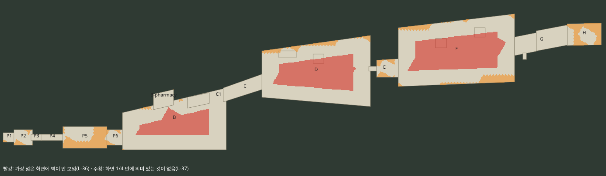
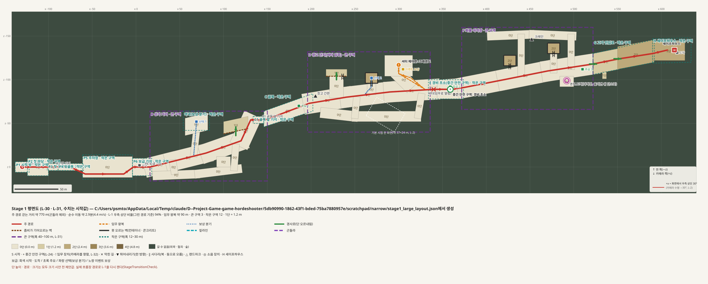
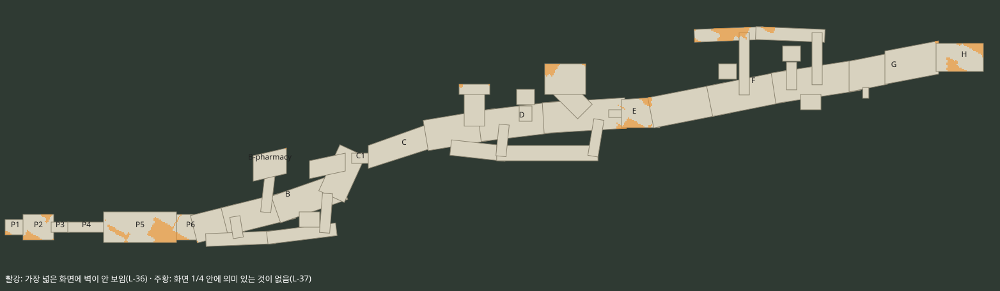

# Stage 1 큰 구역 좁히기 · 빈 곳 채우기 설계안 (L-36 · L-37)

작성일: 2026-10-28 · 기능: 레벨 · 상태: **사용자 확정 · 반영 2026-10-28**(L-38, 8장 · [log/016-code-stage1-lanes.md](log/016-code-stage1-lanes.md)). 7장 질문은 모두 설계안대로 답함.

관련: L-36(어디서든 가장 넓은 화면에 벽 하나), L-37(화면 1/4마다 의미 있는 것), L-31(큰 · 작은 구역), L-34(튜토리얼 Stage 1), [가이드 맵](guide-map.md) 10장(공간 검사), [튜토리얼 시나리오](stage1-tutorial-scenario.md).

## 1. 지금 (공간 검사 `space.py`)

빨강 = 가장 넓은 화면(약 37 × 24 m)에 벽이 안 보임, 주황 = 화면 1/4(약 18.7 × 12.1 m) 안에 의미 있는 것이 없음.

- 벽이 안 보이는 곳 **27%** — 큰 구역 B 26% · D 34% · F 38%(가운데가 통째로 빨강). 큰 구역이 길 방향으로 140 ~ 150 m, 가로로 50 ~ 90 m인 넓은 사다리꼴 하나라서.
- 의미 없는 곳 8% — 작은 구역 P5 주차장 58% · H 55% · E 22% · P2 19% · P6 16%.

## 2. 방법

1. 큰 구역 하나를 넓은 판 대신 **길(레인)의 그물**로 다시 짓는다.
   - **주 길**: 경로를 따라 폭 22 ~ 24 m. 길 한가운데에서도 양쪽 벽이 화면 안에 든다.
   - **옆길**: 폭 8 ~ 12 m, 주 길과 나란히 — 웨이브가 옆에서 오는 길이 되고(유입 · 압박 설계안 4.2), 돌아가는 선택지.
   - **교차 골목**: 폭 8 m, 주 길과 옆길을 잇는다.
   - **막다른 주머니**: 길 끝에 보상 · 장치 · 무리(L-37 "길의 끝").
2. 길 사이에 남는 곳은 **건물 블록**이 된다 — 게임이 바닥 가까운 빈 곳을 건물 · 담으로 채운다(`BuildUrbanBorders`, 지금도 맵 가장자리에 하는 일). 그래서 어디서든 벽(건물)이 보인다.
3. 그래도 빈 곳은 **의미 있는 것**(보급 · 장치 · 무리 · 드럼통 · 보상)으로 채우고, 작은 구역의 쓸모없는 모서리는 **바닥을 줄여** 없앤다.
4. 지금 있는 것(임무 주머니 · 하역장 · 컨테이너 더미 · 사다리 · 크레인 · 경보 트럭 · 기지)은 모두 길 위나 길 끝에 둔다.

## 3. 구역별 안

### B 거리 (첫 웨이브)

| 길 | 모양 | 무엇이 있나 |
|---|---|---|
| 주 길 | 경로 (16, 0) → (131, −54), 폭 22 m | 가로등 줄 · 경로 위 경계형 무리(지금 그대로) · 첫 시간 무리 |
| 뒷길 | (22, 10) → (118, 2), 폭 10 m | 경계형 3(새) — 웨이브 때 옆에서 오는 길 |
| 교차 골목 2 | x ≈ 43, x ≈ 113 | 주 길 ↔ 뒷길 |
| 약국 곁길 | (66, −14) → (69, −40) | 약국 분기로(지금 그대로) |
| 가게 앞마당 | (92 ~ 108, −12 ~ 0) 막다른 곳 | 곁 상자: 탄약 1 · 투척물 1(새) |
| 드럼통 | 입구 (28, −4) | 드럼통 2(새) — 첫 웨이브에서 써 보기 |

- **C1 기지가 B → C의 유일한 길**이 된다(넓은 거리를 돌아가는 길이 없어짐) → 기지 문 3초를 한 번 더 지나게 됨(7장 ②).

### D 창고 단지 (정점 · 크레센도)

| 길 | 모양 | 무엇이 있나 |
|---|---|---|
| 주 길 | (198, −73) → (340, −89), 폭 24 m | 창고 간판 · 셔터(임무로 열림) |
| 하역장 길 | (229, −84 ~ −102), 폭 16 m | 하역장 경사로 · 사다리, 경사로 아래 잠든 3(새) |
| 컨테이너 더미 길 | (269, −86 ~ −92) | 더미 위 사다리 · 위에 MP5 · 화염병(지금 그대로) |
| 임무 길 + 주머니 | (312, −94) → (300, −106), 주머니 (284 ~ 316, −128 ~ −104) | 제어판 진지(지금 그대로) |
| 팔레트 길(남쪽) | (214, −62) → (322, −58), 폭 12 m | 팔레트 · 상자, 끝에 보상 상자(구급상자 1, 새) |
| 교차 골목 2 | x ≈ 251, x ≈ 324 | 주 길 ↔ 팔레트 길, 동쪽 골목에 버튼(옆 지름길 셔터, 선택 임무, 새) |

### F 화물 야적장 (높은 곳)

| 길 | 모양 | 무엇이 있나 |
|---|---|---|
| 주 길 | (374, −91) → (522, −118), 폭 24 m | 2번 더미 사다리, 컨테이너 엄폐 |
| 3번 더미 길 | (477, −110 ~ −127) | 3번 더미 사다리 |
| 북쪽 길 | (404, −150) → (500, −150), 폭 10 m | 크레인 아래 보급(탄약 · 파편 수류탄, 새), 시작 잠든 4, 끝 드럼통 · 경계형 2(새) |
| 교차 골목 2 | x 440, x 497 | 주 길 ↔ 북쪽 길, 잠든 2 · 탄약 상자(새) |
| 트럭 자리 | (484 ~ 500, −104 ~ −92) | 경보 트럭(지금 그대로) |

### 작은 구역 손질

- **P5 주차장**: 바닥을 z ±12로 줄임, 남쪽 길 차 트렁크 탄약(조용히 돌아가는 길의 보상) · 서쪽 입구 경계형 1 · 동쪽 구석 투척물 1 · 북서 구석 드럼통.
- **H 세이프하우스**: 데크를 세이프하우스 둘레로 줄임(37 × 22 m), 문 앞 경계형 3(문 3초를 누를 때 압박, L-35) · 옆 구석 탄약.
- **E 초소**: 북쪽 구석 1회 산탄총(R870) — 무기 고르기. **P6**: 기지 밖 탄약. **P2**: 북서 구석 상자.

## 4. 결과 (설계안을 같은 검사로)

| | 지금 | 설계안 |
|---|---:|---:|
| 바닥 넓이 | 39,402 m² | 24,321 m² |
| 벽이 안 보이는 곳 | 27% | **0%** |
| 의미 없는 곳 | 8% | 5% |
| B · D · F 벽 안 보임 | 26 · 34 · 38% | 0 · 0 · 0% |
| B · D · F 빈 곳 | 1 · 4 · 7% | 0 · 1 · 5% |
| 작은 구역 빈 곳(P5 · H · E · P2) | 58 · 55 · 22 · 19% | 27 · 23 · 15 · 19% |

- 남은 빈 곳은 작은 구역 모서리 · F 북쪽 길 끝 — 반영할 때 실제 렌더를 보며 마저 채우거나 줄인다.
- 다시 만들기: `python tools/level-guide/narrow_draft.py <폴더>` → `python tools/level-guide/space.py <폴더>/stage1_large_layout.json out.svg --proposals`.

## 5. 반영할 때 바뀌는 것

- 맵 데이터: B · D · F의 넓은 영역 3개 → 길 영역 여러 개, P5 · H 바닥 줄임, C1 기지 바닥, 새 보급 · 무리 · 드럼통 · 버튼(3장 "새").
- **무리 영역 다시 배치**: 지금 잠든 무리는 36 × 40 m 같은 넓은 사각형에 흩어져 있어 길 밖으로 나간 부분이 생긴다 — 길 위로 옮기고 수를 맞춘다.
- **웨이브 입구 다시 배치**: 숨은 입구 58곳 중 길 밖으로 나가는 것은 건물 블록 문 · 골목 끝으로 옮긴다(두 방향 웨이브가 옆길 · 교차 골목에서 오게).
- 바닥 길(보도)은 경로를 따라 자동으로 깔림. 가이드 맵(경험 순서)은 그대로, 평면도 · 보드만 다시 그림.
- 검사: `LargeStageCheck`(통과 · 보급 도달 · 기지 · 관문), `space.py` 목표 0%에 가깝게.

## 6. 장단점

| | 좋은 점 | 나쁜 점 |
|---|---|---|
| 길 그물 | 어디서든 벽이 보여 위치를 앎, 옆길 · 교차 골목으로 포위 · 우회 선택지, 막다른 주머니가 탐색 보상 | 한 판의 넓은 교전이 줄어듦(대신 교차로가 교전 장소), 무리 · 입구를 다시 놓아야 함 |
| 바닥 줄이기(작은 구역) | 쓸모없는 모서리가 사라짐 | 탁 트인 느낌이 줄어듦 |

## 7. 확인할 것

1. 주 길 폭 **22 ~ 24 m**, 옆길 8 ~ 12 m로 좋은지(더 넓게 · 좁게)
2. **C1 기지가 B → C의 유일한 길**이 되는 것(기지 문 3초를 또 지남)이 괜찮은지, 아니면 C1 옆에 좁은 우회 골목을 둘지
3. 3장 "새"로 표시한 채우기(보급 · 무리 · 드럼통 · 버튼 · E 산탄총)가 괜찮은지, 빼거나 더할 것
4. 반영 순서: B → D → F 한 구역씩(구역마다 렌더 · 검사) 추천

## 8. 반영 결과 (2026-10-28)

사용자: "설계안대로 진행해줘. 주 길 22~24 m, C1 기지 필수 통과 OK, 채우기 목록도 그대로. B → D → F 순서로 한 구역씩 반영하고 렌더 확인해줘." → B → D → F → 작은 구역 순서로 반영, 구역마다 `space.py` · `LargeStageCheck` · 렌더([log/016-code-stage1-lanes.md](log/016-code-stage1-lanes.md)).

| | 반영 전 | 설계안 | 반영 |
|---|---:|---:|---:|
| 바닥 넓이 | 39,402 m² | 24,321 m² | 24,159 m² |
| 벽이 안 보이는 곳 | 27% | 0% | **0%** |
| 의미 없는 곳 | 8% | 5% | 6% |
| B · D · F 빈 곳 | 1 · 4 · 7% | 0 · 1 · 5% | 2 · 5 · 6% |
| 작은 구역 빈 곳(P5 · H · E · P2) | 58 · 55 · 22 · 19% | 27 · 23 · 15 · 19% | 22 · 19 · 17 · 19% |

설계안과 달라진 것:

- **무리 다시 놓기**: 넓은 사각형 무리를 그냥 가까운 길로 옮기면 모두 주 길에 몰려 D 팔레트 길 · 임무 주머니가 비었다(D 빈 곳 33%). 무리를 나눠 주 길 · 옆길 · 주머니에 고루 놓음(총 수는 같음). D 셔터 옆 보급 탄약 1(`d_shutter_ammo`)을 더함.
- **드럼통은 목록대로만**: 빈 곳을 메우려 D · F에 드럼통 4개를 더 놓아 봤다가 뺐다 — L-33 4번이 D · F의 드럼통을 G로 옮겼기 때문. 대신 무리 자리를 옮김(D 5% · F 6%).
- **길 사이 담**: 게임은 북쪽 넓은 빈 곳에만 건물을 세우고 담은 7 m 간격으로 드문드문 놓아, 좁은 길 사이가 맨땅으로 보였다. 건물이 없는 가장자리마다 3 m 담을 잇달아 세움(먼 쪽은 골함석, 카메라 쪽은 철망).
- **G 드럼통**: 장식 드럼통이었음(I-131) → 폭발 드럼통.
- F 북쪽 길 끝 드럼통은 (503, −148)이 길 밖이라 (500, −147)로, 경계형 2는 (490 ~ 500)에서 (462 ~ 472)로.
