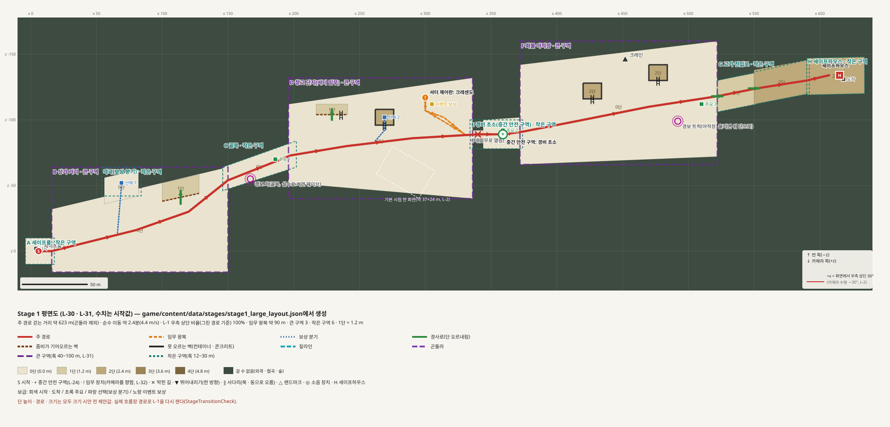
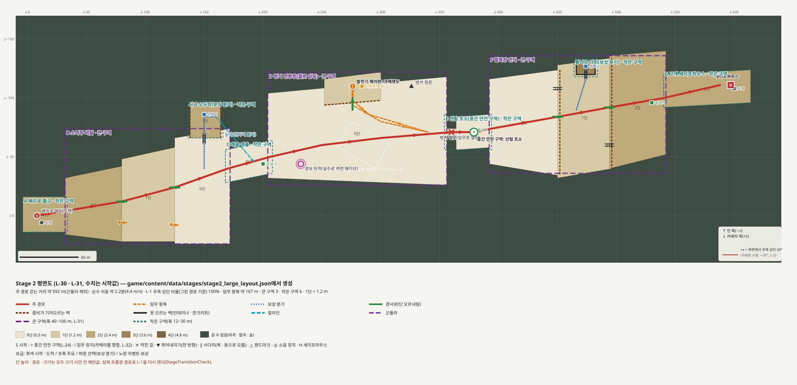
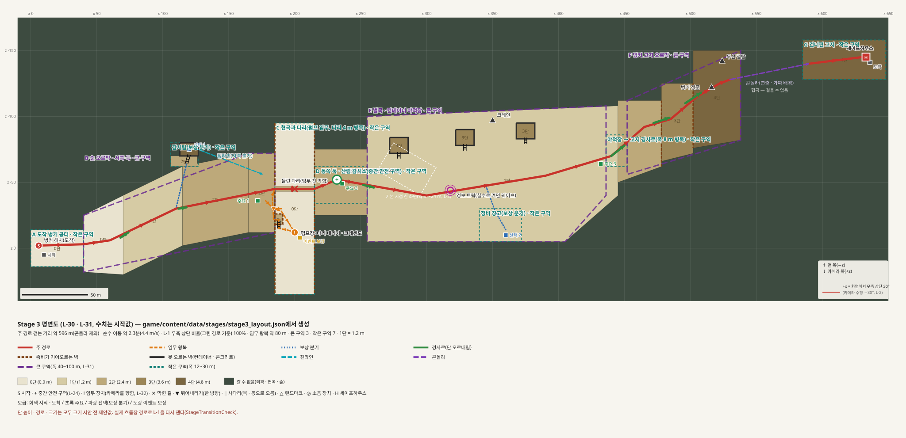

# 큰 스테이지 시안 (Stage 1 · 2 · 3)

> 2026-10-27 작성. 결정: [L-30 규모 · Stage 3](features/level/decisions.md#l-30-스테이지-규모-기준과-stage-3), [L-31 구역 등급](features/level/decisions.md#l-31-작은-구역과-큰-구역), [L-32 버튼 · 사다리 노출](features/level/decisions.md#l-32-버튼과-사다리-노출). 규칙: [레벨 디자인 규칙](level-design-rules.md). 모든 수치 · 배치는 `[임시]` 시작값이고 플레이 측정 전이다.

지금 크기 시안(옛 "Stage 2 크기 시안", [Stage 2 평면도](stage2-floorplan.md) 11 · 12장)의 규모를 기준으로 삼고 그 시안을 **Stage 3**으로 둔다. Stage 1 · 2는 같은 규모의 새 시안으로 지었다. 지금 메뉴 흐름의 작은 Stage 1 · 2는 그대로 있고, 새 시안은 실행 옵션으로만 플레이한다.

```
Start-Game.ps1 -LargeStages    # 큰 Stage 1 → 2 → 3 (세이프하우스 해치로 이어짐, 혼자만)
Start-Game.ps1 -Zone P1 -Squad 0  # AI 동료 없이 혼자(-Squad 0 · 1 · 3, 메뉴 저장값보다 우선)
Start-Game.ps1 -Zone D         # 구역 테스트: 메뉴 없이 Stage 1 D 구역 입구에서 시작(-Zone 2:D = Stage 2), 레벨 가이드 맵 9장
Start-Game.ps1 -Stage3Draft    # Stage 3(크기 시안)에서 바로 시작 (옛 -Stage2Draft도 같음)
```

## 1. 한눈에

| | Stage 1 · 창고 지구 | Stage 2 · 숲속 벙커길 | Stage 3 · 협곡 감시소 길 |
|---|---|---|---|
| 테마 | 도시 · 창고(`theme: urban`) | 숲 · 벙커 야외 | 숲 · 협곡 · 야적장 야외(L-28) |
| 맵 데이터 | `stage1_large_layout.json` | `stage2_large_layout.json` | `stage3_layout.json`(옛 `stage2_layout.json`) |
| 주 경로(평면도) | 623 m | 592 m | 596 m(+ 곤돌라) |
| 흐름장 출구 경로(`LargeStageCheck`) | 664 m(2.5분) | 634 m(2.4분) | 620 m(2.3분) |
| L-1(평면도) | 100% | 100% | 100% |
| 큰 / 작은 구역 | 3 / 5 + 분기 1 | 3 / 4 + 분기 2 | 3 / 5 + 분기 2 |
| 시작 | 세이프룸(문 · 북쪽 벽 스위치) | 배수로 해치(2단) | 벙커 해치 |
| 임무(크레센도) | 창고 셔터 ← 북쪽 창고 벽 제어판 | 벙커 철문 ← 발전기 단 제어판 | 들린 다리 ← 협곡 펌프 |
| 중간 안전 구역 | 경비 초소 | 산림 초소 | 산림 감시소 |
| 높이 | 거의 평지, 하역장 · 광장 1단, 컨테이너 2단, 고가 2단 | 2단에서 내려가 0단 연병장, 다시 2단 언덕 | 0 → 4단 오르막, 협곡 |
| 다음 | Stage 2(바닥 해치) | Stage 3(바닥 해치) | 없음(마지막, Stage 4 피날레는 미정) |

평면도(`tools/floorplan/render_floorplan.py`로 생성, 보라 굵은 점선 = 큰 구역, 청록 점선 = 작은 구역):

- 
- 
- 

## 2. 구역 (L-31)

> **2026-10-28 Stage 1 = 기본 캠페인 튜토리얼(L-34)**: 왼쪽(x −142 ~ 0)에 프롤로그 P1 ~ P5, 옛 시작 방은 보급 기지 P6, B 끝에 기지 C1 — 구역마다 하나씩 배운다. 기지 · 세이프하우스로 들어가는 문은 E 3초(L-35), 기지 테이블의 총은 공용(무한, C-33), 구급상자 · 투척물은 사람 수만큼(M-35). [시나리오](features/level/stage1-tutorial-scenario.md), [log/013](features/level/log/013-code-stage1-tutorial.md).

**Stage 1**: A 세이프룸(작은) → B 상가 거리(큰, 섬 블록 · 광장 계단참, 분기: 약국) → C 골목(작은, 폭 18 m, 경보 차) → D 창고 단지(큰, 하역장 · 컨테이너 위 · 셔터 임무, 제어판 진지) → E 경비 초소(작은, 중간 안전 구역) → F 화물 야적장(큰, 컨테이너 2 · 크레인 · 경보 트럭) → G 고가 진입로(작은, 0 → 2단, 특수 적 · 드럼통) → H 세이프하우스(작은). 2026-10-27 가이드 맵 설계안(L-33)으로 경보 · 특수 적 · 드럼통 · 시간 습격 · 길 안내 조명을 옮김 — [가이드 맵 7.3](features/level/guide-map.md#73-맵에-반영할-변경).

**Stage 2**: A 배수로 출구(작은, 2단) → B 소나무 비탈(큰, 2 → 1 → 0단 경사로 · 뛰어내리기 지름길, 분기: 사냥 오두막 바위턱 — 북쪽으로 오르는 사다리, 짚라인으로 여울 복귀) → C 개울 여울(작은) → D 벙커 연병장(큰, 경보 트럭 · 발전기 단 · 철문 임무) → E 산림 초소(작은) → F 벌목장 언덕(큰, 0 → 1 → 2단, 동쪽으로 오르는 지름길 사다리 2, 분기: 통나무 더미 위 3단) → G 고개 세이프하우스(작은).

**Stage 3**: A 벙커 공터(작은) → B 숲 오르막 · 서쪽 둑(큰, 분기: 감시탑) → C 협곡과 다리(작은, 폭 30 m · 다리 4 m) → D 동쪽 둑 · 감시소(작은) → E 야적장(큰, 분기: 정비 창고) → 경사로(작은, 폭 8 m) → F 벙커 고지(큰) → 곤돌라 → G 건너편 고지(작은).

구역 폭은 구역 넓이 ÷ 긴 변(기운 길도 가로질러 잰 폭)으로 잰다. 경로가 큰 구역에서 큰 구역으로 바로 넘어가지 않는다(`LargeStageCheck`가 실제 흐름장 경로로 확인).

Stage 3에 구역 등급을 맞추며 바꾼 것: A 공터 폭 36 → 28 m(z ±14), G 건너편 고지 폭 38 → 30 m. 그 밖의 지형 · 링크는 그대로다(아래 사다리 하나만 옮김).

## 3. 버튼 · 사다리 (L-32)

- **Stage 1 세이프룸 스위치**: 문은 동쪽 벽, 스위치(`wall_button_panel`)는 북쪽 벽 안쪽(문 쪽 끝). 카메라 쪽 벽은 1.1 m로 낮다.
- **임무 제어판**(Stage 1 · 2): 표식 자리 1.4 m 북쪽에 벽 조각을 세우고 그 남쪽 면(카메라 쪽)에 제어함. Stage 1은 북쪽 창고 벽 앞이라 창고 벽에 붙은 것처럼 보인다.
- **세이프하우스 닫기 버튼**: 모든 큰 스테이지가 `safehouse_b`를 쓴다. 버튼이 서쪽 벽 안쪽(화면 남서, 카메라가 벽 뒷면을 봄)에서 북쪽 벽 안쪽(화면 북서) 게임 로컬 `(-4.6, 1.4, -5.55)`로 옮겨졌다. 벽 · 문 · 충돌은 그대로.
- **Stage 3 협곡 복귀 사다리**: `(188,-22) → (183,-22)`(서쪽으로 오름)을 협곡 서쪽 벽에 붙은 2단 바위턱(6 × 8 m, x 185~191, z −26~−18)으로 옮겨 `(188,-15) → (188,-21)` 북쪽으로 오르게 했다. 바위턱 가장자리는 좀비가 기어오른다. 다리 밑을 지나지 않는다는 I-111 조건은 그대로.
- 사다리 방향은 맵 데이터를 읽을 때(`StageLayout`) 오류로 걸러지고, `LargeStageCheck`가 실제로 지은 사다리 · 스위치 · 제어판 · 세이프하우스 버튼에서 카메라 쪽으로 광선을 쏴 벽에 막히지 않는지 확인한다.

## 4. 새 모델 (Codex, [지시문](model-briefs/large-stage-kit.md))

`game/assets/large-stage-kit/`: `safehouse_b` · `wall_button_panel` · `shutter_leaf` · `urban_rowhouse` · `urban_shop` · `urban_warehouse` · `car_wreck` · `bus_wreck` · `dumpster`(삼각형 492 ~ 3,532). 생성: `prototypes/outdoor-kit/tools/large_stage_kit.py`(Blender 5.2, `LARGE_STAGE_KIT_BUILT 9`), 원본 `prototypes/outdoor-kit/source/large-stage-kit.blend`. 도시 외곽은 `LayoutMap.BuildUrbanBorders`가 먼 쪽(북쪽) 경계 밖에 건물, 카메라 쪽 · 서쪽 경계 밖에 낮은 철망을 충돌 없이 깐다.

## 5. 코드

| 무엇 | 어디 |
|---|---|
| 맵 데이터 새 항목: `next_stage` · `theme` · `dressing` · `keys`(제목 · 안내 · 크레센도 문구) · `zones` · `props` · `lamps`, 표식 `kind` · `model`, 사다리 방향 검사 | `StageLayout.cs` |
| 스테이지 번호 · 다음 스테이지 · 문구를 데이터에서, `ForStage(n)`, 세이프룸(`start_room`), 셔터 + 벽 제어판 임무(`kind: shutter / panel`), `safehouse_b` · 바닥 해치, 데이터 소품 · 가로등, 도시 조명 · 바닥색 | `LayoutMap.cs` |
| 공통 환경(길 · 절벽 암반 · 경계 숲 · 컨테이너 더미)과 Stage 3 전용 목록 분리, 숲 산포(Stage 2), 도시 경계(Stage 1) | `LayoutMapEnvironment.cs` |
| `--large-stages` · `--stage3-draft`(옛 `--stage2-draft`) | `GameSession.cs`, `StageMap.Create`, `Start-Game.ps1` |
| 데이터 생성 · 사전 검사(경로 길이 · L-1 · 구역 폭 · 사다리 방향 · 소품이 경로를 막는지) | 데이터 파일이 원본. 생성 스크립트는 커밋하지 않음 |

## 6. 검사

`game/tests/LargeStageCheck.tscn`(헤드리스, `--fixed-fps 60`): 연결 · 규모 · 구역 · 사다리 · 버튼 노출 · 보급 · 위 단 몬스터 경로 · 한 판 진행. 렌더: `game/tests/LargeStageCapture.tscn`(창 모드) → `output/large-stage{1,2,3}-*.png`. 결과는 [작업 기록](features/level/log/001-code-large-stages.md).

## 7. 남은 것

- 경사로는 지을 때 낮은 끝 1.5 m를 뺀 양옆 1칸 줄을 흐름장에서 막는다(`LayoutMap.BuildLink`). 경사로 칸이 낮은 단이라 흐름장이 옆에서 들어가려 하기 때문 — 엔진 쪽(`TierMap.CanStep`) 수정은 따로.
- 실제 플레이(전투가 들어간 시간 · 난이도 · 20분, 이동 피로), 멀티(방에서는 다른 PC가 지금 스테이지를 지음), 메뉴 연결과 지금 Stage 1 · 2 교체(확정 뒤).
- Stage 1 · 2는 그레이박스 + 키트 소품 1차다. Stage 3 수준의 환경 마감(숲 품질 구역, 지형 경계 마감, 랜드마크 모델)은 아직 없다. Stage 2 임무 왕복이 167 m로 Stage 3(80 m)의 두 배 — 플레이로 판단.
- Stage 4(피날레, L-25)는 미정.
