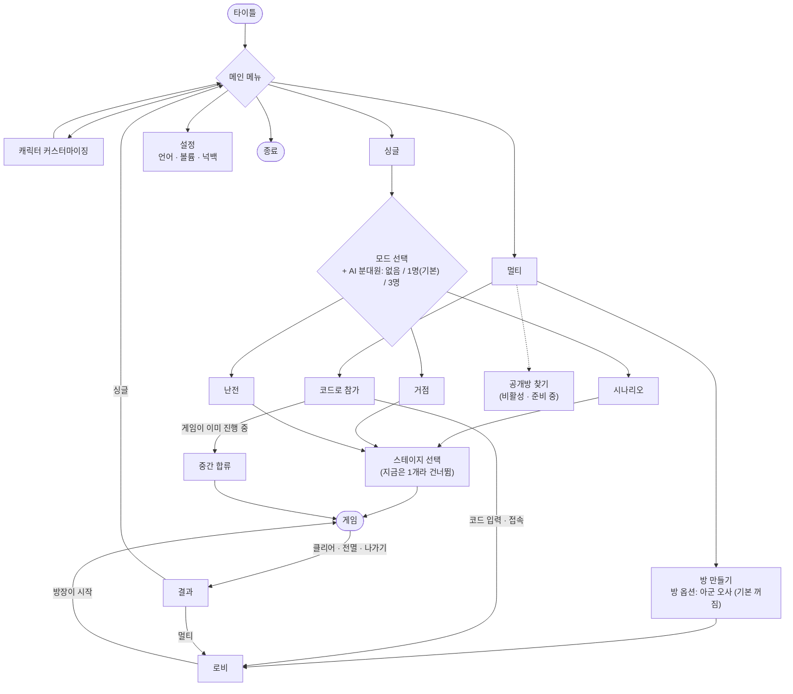
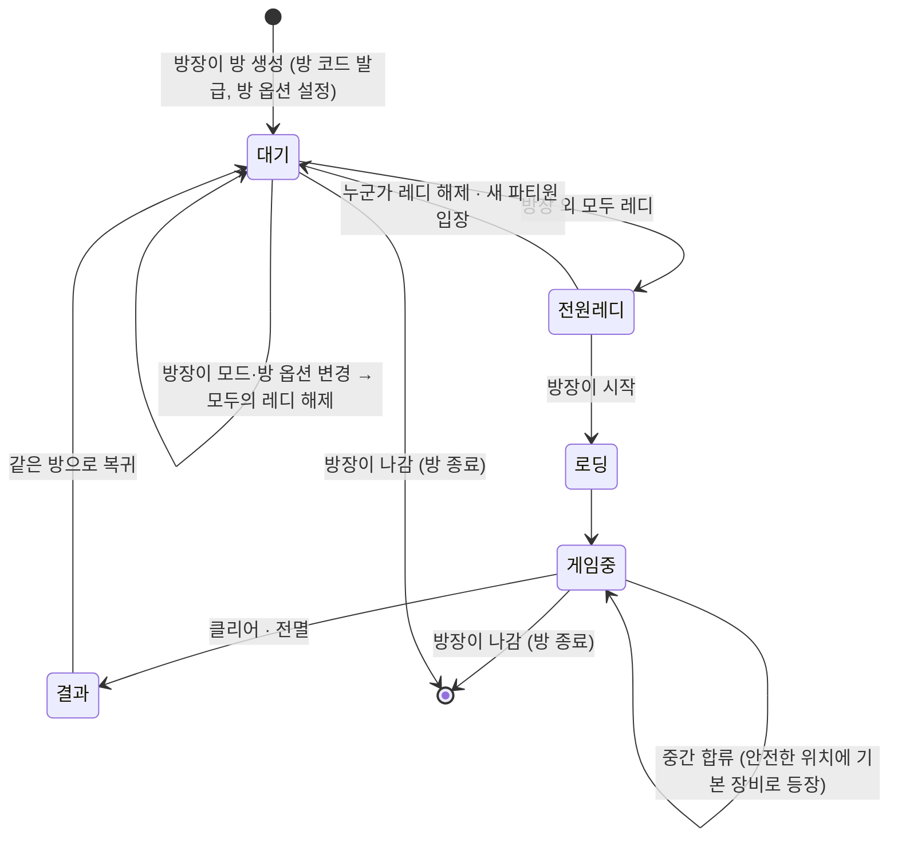
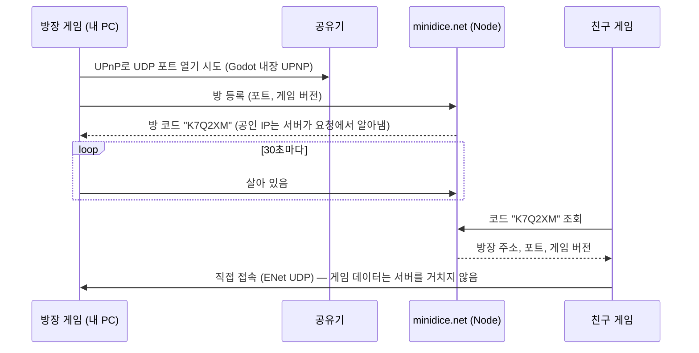

# 메뉴 구조 · 게임 모드 · 멀티플레이 계획

> **상태**: 기획 정리 (2026-10-20). 결정 사항은 6장. **5.4의 ① 메인 메뉴 재구성은 2026-10-20 구현**(멀티는 껍데기, AI 분대원은 선택만 저장). **2장 로비는 2026-10-21 1차 구현**(참가자·준비·모드·시작·결과 대신 재시작 시 방으로, 2인, 방 옵션·방 코드 없음 — decisions.md M-21). **3.1 생존·서바이버 1차 버전은 2026-10-21 구현**(Stage 1 창고에서, decisions.md M-22). 나머지는 구현 전입니다.
> **현재 게임**: `game/`은 "싱글 · 모드 3종(거점·난전은 1차 버전) · 스테이지 1개"에 해당합니다. 메인 메뉴는 1장 구조(공개방·스테이지 선택 제외)를 따릅니다.
> 관련 결정: `doc/idea.md`의 D-2(인원), D-9(네트워크).

---

## 1. 메뉴 구조



- **공개방 메뉴**는 회색으로 비활성화해 두고 "준비 중"이라고 표시하는 것을 권합니다. 만드는 비용은 거의 없고, 나중에 기능을 켤 때 메뉴 구조를 바꾸지 않아도 됩니다.
- **스테이지 선택**은 화면 흐름에만 자리를 잡아 둡니다. 스테이지가 1개뿐인 지금은 자동으로 건너뜁니다.
- 커스터마이징 결과(종, 색, 장식)는 싱글과 멀티가 같이 씁니다. 멀티에서는 접속할 때 내 외형 정보를 방장에게 보냅니다.

---

## 2. 로비 (멀티)



| 항목 | 규칙 |
|---|---|
| 인원 | 최대 **6명** (방장 포함) |
| AI 분대원 | **없음.** 멀티는 사람끼리만 (싱글은 옵션, 6장 M-11) |
| 방 종류 | **비공개방만.** 방 코드를 아는 사람만 들어옴 |
| 모드 선택 | 방장만 바꿀 수 있음. 바꾸면 모두의 레디가 풀림 |
| 방 옵션 | 방장이 방을 만들 때 정하고 로비에서 바꿀 수 있음. 바꾸면 모두의 레디가 풀림. 지금 옵션: **아군 오사 (기본 꺼짐)** |
| 시작 | 방장 외 전원이 레디해야 방장의 [시작] 버튼이 켜짐 |
| 중간 합류 | 허용. 합류자는 근처 아군 옆이나 마지막 체크포인트에 **초기 장비로** 등장(싱글 시작과 같은 장비). 인원 보정은 합류 이후 새로 나오는 몬스터부터 적용(4장) |
| 방장 이탈 | **지금은 방이 끝남.** 나중에 남은 사람 중 한 명이 방장을 이어받게(호스트 이전) 할 계획. 중간 합류용 "스테이지 상태 전체 전송"을 만들면 그 데이터를 새 방장에게 넘기는 방식으로 재활용 가능 |

---

## 3. 게임 모드

용어는 [프로젝트 용어 사전](glossary.md)을 따른다. 콘텐츠 계층은 **시나리오에 한해 캠페인 → 스테이지 2단계 추천**이며, 현재 메뉴·저장 계약을 바꾸는 확정 결정은 아니다. [시나리오 레벨 디자인 목표](scenario-level-design.md)의 시간·전투 비율·아이템 배치는 **생존·서바이버에 적용하지 않는다**. 아래 “레벨 없음”은 캐릭터 성장 레벨업이 없다는 뜻이다.

| | 시나리오 | 거점 (구 생존) | 난전 (구 서바이버) |
|---|---|---|---|
| 느낌 | L4D 캠페인 | 타르코프식 디펜스 | 뱀파이어 서바이버즈 |
| 진행 | A → B 일자 진행, 레벨 없음 | 거점 방어 · 파밍 | 시간을 버티며 성장 |
| 성장 | 없음 (바닥 무기·투척물) | **인벤토리**, 장비 가져가기 | 레벨업마다 **특수 능력 선택** |
| 주된 적 | 달려드는 좀비, 원시적인 몬스터 | **총 쓰는 적** 비중이 큼 | 대량의 잡몹 + **스킬 쓰는 RPG식 보스** |
| 지금 상태 | **프로토타입 있음** (`game/`) | **1차 버전**(3.1): 발전기 거점 방어 웨이브 3개, 뒤 웨이브에 총 쓰는 적. 인벤토리·파밍 없음 | **1차 버전**(3.1): 사방의 약한 무리 + 스킬 보스. 레벨업 능력 없음 |

공통으로 쓰는 것: 캐릭터, 무기·투척물·몬스터 데이터, 넉백, 사운드, 다국어 테이블. 모드는 "스테이지 규칙 + 등장 몬스터 구성 + 성장 방식"만 다르게 하는 쪽이 좋습니다.

### 3.1 거점·난전 1차 버전 (2026-10-21 구현, M-22)

> **이름**: 2026-10-21 화면 이름을 생존 → **거점 (Outpost)**, 서바이버 → **난전 (Onslaught)** 으로 바꿨다(M-23). 코드 ID는 그대로 `GameMode.Survival` / `GameMode.Survivor`이고, 아래 표와 결정 기록의 예전 항목은 구분하기 쉽게 옛 이름을 그대로 둔다.

사용자가 영상 촬영용으로 요청했다. 사용자 답(2026-10-21): **두 모드 모두**, 한 판 **약 3분**, 서바이버에 꼭 보일 것은 **대량 잡몹과 스킬 쓰는 보스**, 생존에 꼭 보일 것은 **거점 방어**. 레벨업 능력 선택·인벤토리·파밍·탈출은 이번 범위가 아니다. 기존 전투·무기·몬스터·HUD를 그대로 쓰고 새 맵은 만들지 않았다.

| | 생존 | 서바이버 |
|---|---|---|
| 맵 | Stage 1 그대로, 창고 한가운데(66, 1.6)에서 시작. 거리 쪽 입구와 **올라간 셔터** 두 곳이 열려 있고 세이프룸 문은 닫힘. 선반은 엄폐물로 남김 | 같음. 단 창고 **선반을 빼서** 넓은 홀(드럼통 2개 추가) |
| 목표 | 창고 한가운데 **발전기(거점, 내구도 900)**를 지킨다. 준비 8초 → 웨이브 40·45·50초, 사이 휴식 10초(약 2분 43초). 마지막 웨이브가 끝나면 클리어 | **2분 30초** 버티면 보스 등장. 보스를 쓰러뜨리면 클리어 |
| 적 | 무리가 거리(x 40~49)나 야적장(x 89~99) 쪽에서 화면 밖이면 거기서 나와 두 입구로 들어옴. 웨이브 2는 20%, 3은 30%가 무장 랫서판다, 웨이브 3 첫 무리에 정예병 1. 동시에 60마리까지 | 살아 있는 사람 주변 14~22m의 화면 밖 칸에서 1.3초마다 한 무리. 무리 크기 3 → 8로 늘어남(보스 뒤에는 절반). 체력은 데이터의 60%. 동시에 일반 70마리까지(디렉터 상한) |
| 거점·보스 규칙 | 일반 적은 **사람보다 발전기가 가까우면** 발전기로 가서 때린다(공격 준비 → 1회 타격, 공격력은 데이터 값). 흐름장 목표에 발전기를 더함. 총 쓰는 적은 사람을 쏨 | 보스 `boss`(황소 외형 1.7배, 체력 2600): 황소 돌진, **내려찍기**(4.5m 안에 들면 1.1초 동안 반경 5.5m 빨간 원이 차오른 뒤 22 피해 + 날려 보냄, 자기 부하도 날아감, 6초마다), **소환**(13초마다 주변에 일반 6마리), 체력 50% 이하 **격노**(이동 1.35배, 스킬 대기 0.6배). 섬광탄은 내려찍기를 끊음 |
| 지는 조건 | 발전기 0, 또는 분대 전멸(기존 규칙) | 분대 전멸 |
| HUD | 위 가운데 막대: 거점 내구도 %. 목표 칸: 웨이브 번호·남은 초 / 휴식·보충 안내. 결과 화면에 막은 웨이브 수 | 막대: 보스 등장까지 남은 시간 → 보스 체력 %. 결과 화면에 보스 처치 여부 |
| 보급 | 발전기 옆 M4·R870, 탄약 더미 2, 구급상자 1, 수류탄·화염병 | M249·Benelli, 홀 구석 탄약 더미 3·구급상자 2, 수류탄 2·화염병 1 |

- **2026-10-21 2단계**: 누가 언제 나오는지(무장 비율·정예병·잡몹 체력)는 모드 테이블, 보스는 3페이즈·스킬 데이터로 옮겼다(M-24, [몬스터 테이블 규격](mode-monster-tables.md)). 위 표의 보스 수치(체력 2600·50% 격노)는 1차 당시 값이다.
- 수치는 `game/content/data/mode_rules.json`(T-3, 잘못된 값은 오류 목록), 보스 돌진은 `monster_traits/boss_charge.json`, 보스 행은 `monsters.csv`의 `boss`. 모두 **제안값**이며 플레이로 조정한다(I-26).
- 메뉴 싱글의 모드 탭과 방의 모드 탭은 `GameSession.PlayableModes`를 따르므로 두 모드가 바로 열린다. 화면 왼쪽 위 제목에 모드 이름이 붙는다("거점 · STAGE 1 · 창고 지구").
- **멀티**: 방장이 고를 수 있고 방장이 규칙을 계산한다. 파티원은 적·끝 상태를 기존 동기화로 받고, 위 막대 값은 스냅샷의 셔터 진행 바이트를 다시 써서 받는다. 웨이브·남은 시간 문구는 각자 시계로 계산한다. 보스 내려찍기 원·소환 글자는 파티원 화면에 나오지 않는다(I-77). 2인 실제 플레이는 확인하지 않았다.
- 검사: `game/tests/ModeCheck.tscn`(창 모드면 `output/mode-*.png`).
- **2026-10-21 5단계**: 난전은 Stage 1 창고 대신 전용 들판에서, 바닥 진열대로 무기 두 개를 고르고 시작한다(위 표의 난전 맵·보급 줄은 1차 당시 값, [몬스터 테이블 규격](mode-monster-tables.md) 5장).
- **다음 방향**(2026-10-21 기획, 구현 전): 모드 이름 변경, 모드별 몬스터 테이블·정비 시간·보스 페이즈, 생존 = 파밍·인벤토리·탄 종류, 서바이버 = 무제한 예비탄·무기 고르기·넓은 평지는 [무기·모드·몬스터 개편 방향](mode-weapon-direction.md)(M-23~M-26).

---

## 4. 인원별 밸런스

**기준은 4인**입니다. 1~6인일 때 몬스터를 **일반**과 **네임드**로 나눠서 %로 조정하고, 표는 CSV로 관리합니다.

### 4.1 일반 / 네임드 구분

`monsters.csv`의 `tier` 열은 2026-10-20 시체 등급 분리 작업에서 구현했습니다. 현재는 일반/네임드 시체 유지 정책에 연결되어 있으며, 아래 인원 보정 적용은 아직 별도 계획입니다. 시체 정책은 [시체 유지·정리](corpse-retention.md)를 참고합니다.

| tier | 해당 | 인원 보정 |
|---|---|---|
| `common` | 감염체, 인간형·기어오는 감염체, 야생 라쿤, 무장 랫서판다 | **등장 수**, 체력, 공격력 |
| `named` | 풍선 기생충, 박치기 황소, 낚아채는·덮치는·토사물 감염체, 랫서판다 정예병, 나중의 보스 | 체력, 공격력만. **등장 수는 인원과 관계없이 같음** |

### 4.2 표

`content/data/party_scaling.csv` (제안)

```csv
players,common_count_pct,common_hp_pct,common_damage_pct,named_hp_pct,named_damage_pct
1,50,80,100,50,100
2,70,90,100,67,100
3,85,95,100,83,100
4,100,100,100,100,100
5,120,105,105,130,110
6,140,110,110,160,120
```

- **네임드**는 처음 정하신 곡선(1인 50%/100%, 4인 100%/100%, 6인 160%/120%)을 그대로 씁니다. 2·3·5인은 그 사이를 고르게 채웠습니다.
- **일반**은 인원 차이를 주로 **등장 수**로 맞춥니다. 체력까지 크게 올리면 "권총 세 발이면 죽던 좀비가 다섯 발"이 되어 손맛이 달라지므로, 체력·공격력 보정은 ±20% 안으로 약하게 잡았습니다. 해 보고 조정할 시작값입니다.

### 4.3 적용 규칙

- 체력·공격력은 **몬스터가 생길 때** 정합니다. 이미 나와 있는 몬스터는 바뀌지 않으므로, 중간 합류나 이탈 때 체력이 갑자기 튀지 않습니다.
- 등장 수는 두 곳에 적용합니다.
  - 맵에 미리 깔린 일반 몬스터: 스테이지 시작 때 % 만큼 줄이거나 늘림
  - 호드 디렉터가 부르는 웨이브: 부를 때마다 그 순간의 인원으로 계산
- 네임드는 맵 배치 수와 디렉터의 등장 간격 모두 인원과 관계없이 그대로입니다.

---

## 5. 네트워크

### 5.1 구조

- **방장 PC가 서버**입니다(호스트 권한). 좀비 AI, 피격 판정, 줍기는 모두 방장이 계산합니다. 파티원은 **입력**(이동, 조준, 사격, 버튼)을 보내고 **결과**를 받아서 그립니다.
- 지금 코드의 `Player.SetControls(이동, 조준, 사격)`과 `PressSlot`, `PressThrow` 같은 입력 함수가 그대로 "네트워크로 보낼 입력"이 됩니다. 이 부분은 이미 나뉘어 있어서 출발점이 좋습니다.
- 좀비 수가 많으므로 기존 기획(`idea.md` 8.2, 8.4)대로 갑니다.
  - 좀비는 위치를 띄엄띄엄 보내고 사이를 보간합니다.
  - 일반 몬스터는 죽을 때 "죽음 + 날아가는 방향"을 보내고 이후 시체 물리는 각자 화면에서 계산합니다. 걷기·구르기·폭발에 밀려도 플레이어 이동이나 전투 판정에는 영향을 주지 않습니다.
  - 네임드 시체는 호스트가 ID·지면 위치·방향·생성/만료 시각을 확정해 공유하고 외형도 고정합니다. 2026-10-20 로컬 고정/일반 물리 반응까지 구현했으며, 이 네트워크 전송은 아직 계획입니다. 세부 계약은 [시체 정책](corpse-retention.md) 참고.

### 5.2 연결 방식: 지금(임시) → 출시

Godot의 `MultiplayerPeer`는 연결 방식만 갈아 끼울 수 있게 되어 있습니다. 그래서 게임 코드(RPC, 동기화)는 그대로 두고 연결 방식만 바꿉니다.

- **출시**: **Steam 로비 + Steam 중계**로 갑니다(D-9 유지). 친구 초대, 공유기 문제, IP 노출, 공개방 목록이 한 번에 해결됩니다.
- **지금**: Steam을 붙이기 전까지 친구 테스트용 **임시 방식**을 씁니다. 아래 5.3에서 고릅니다.

### 5.3 임시 방식: IP를 매번 입력하지 않고 접속하기

> **2026-10-21 결정·구현**: 방 코드 대신 **공개 방 목록**으로 갔다(decisions.md M-6). 서버는 Minidice의 새 서비스 `lobby.minidice.net`(게임별 하위 경로 `/hordeshooter/rooms`, 계약은 Minidice `docs/LOBBY_SPEC.md`). 아래 A안의 등록·갱신·만료·버전 확인·UPnP는 그대로이고, 코드 입력 대신 목록에서 누른다. 같은 공유기면 LAN 주소로 들어간다. 서버는 2026-10-21 설치했다. 다른 집 접속 확인과, UPnP가 없는 공유기(현재 사용자 공유기 포함)를 위한 대책(포트포워딩 안내 또는 중계 D안)이 남아 있다.

집 IP는 공유기를 껐다 켜거나 통신사 사정으로 바뀝니다. 그래서 IP 직접 입력은 테스트 때마다 IP를 알려 줘야 해서 번거롭습니다. 대안은 네 가지입니다.

| 방식 | 친구가 하는 일 | 내가 할 일 | 코드 작업 | 평가 |
|---|---|---|---|---|
| **A. 방 코드 (추천)** | 6자리 코드 입력 | 처음 한 번 포트 열기(자동 시도) | 게임 + minidice.net API | IP가 바뀌어도 상관없음. Steam 전환 후에도 "코드로 참가" 화면을 그대로 쓸 수 있음 |
| B. 고정 주소 (DDNS) | `myhouse.duckdns.org` 한 번 저장 | DDNS 가입, 포트포워딩 | 없음 | 가장 간단하지만 주소 입력 칸은 남음 |
| C. 가상 LAN (Tailscale, ZeroTier, Radmin VPN) | 프로그램 설치, 내 네트워크에 가입 | 초대 | 없음 | 포트 열기 필요 없음. 친구에게 설치를 부탁해야 함 |
| D. 중계 서버 | 코드 입력 | 없음 | minidice.net에 중계 기능 | 어떤 환경에서도 됨. 지연과 서버 부하가 늘어남 |

**추천: A를 기본으로 하고, 포트를 열 수 없는 환경이면 D를 붙입니다.** 코드가 준비되기 전에 첫 테스트를 당장 하고 싶다면 C(코드 작업 없음)로 먼저 해 볼 수 있습니다.

#### A. 방 코드 방식의 흐름



- **공인 IP**: 방장이 알 필요가 없습니다. 서버가 등록 요청이 들어온 주소를 보고 기록합니다. 그래서 IP가 바뀌어도 방을 새로 만들 때마다 자동으로 맞춰집니다.
- **포트 열기**: 게임이 Godot 내장 `UPNP`로 공유기에 포트를 자동으로 열어 달라고 요청합니다. 공유기가 UPnP를 지원하지 않으면 공유기 설정에서 UDP 포트 하나를 **한 번만** 포트포워딩하면 됩니다(방장인 나만).
- **안 될 때 알림**: 서버가 본 IP와 공유기가 알려 준 바깥 IP가 다르면, 통신사가 공유기 앞에 또 하나의 공유기를 둔 환경(CGNAT)입니다. 이때는 포트를 열어도 들어올 수 없습니다. 게임이 이를 감지해 "직접 접속 불가 → 중계(D) 필요"라고 알려 줍니다.
- **버전 확인**: 등록할 때 게임 버전을 같이 올립니다. 친구 게임의 버전이 다르면 접속 전에 "버전이 다릅니다"라고 막습니다.
- **만료**: "살아 있음" 신호가 1~2분 끊기면 서버가 그 코드를 지웁니다.
- **Node API (제안)**: `POST /rooms`(등록 → 코드), `POST /rooms/:code/alive`, `GET /rooms/:code`(조회), `DELETE /rooms/:code`(방 닫기).
- **주의**:
  - 등록 API에 간단한 비밀 키를 둬서 아무나 방을 만들지 못하게 합니다. 키가 실행 파일에 들어가므로 강한 보안은 아니지만 임시 테스트용으로는 충분합니다.
  - 방장 IP는 코드를 아는 친구에게만 전달됩니다.

### 5.4 만드는 순서 (추천)

**로비를 먼저 만들기보다, 2명이 같이 플레이되는 것을 먼저 확인하는 쪽을 권합니다.** 동기화가 되지 않으면 로비가 있어도 쓸 데가 없습니다. 그리고 가장 큰 위험(좀비 수백 마리 동기화)이 거기에 있기 때문입니다.


- ①은 네트워크와 상관없이 바로 할 수 있습니다.
- ②는 같은 PC에서 게임 창 두 개(127.0.0.1)로 개발하므로 서버가 필요 없습니다. 세부 설계(누가 결정하고 무엇을 보내는지, 검사 방법)는 [2인 동기화 MVP 설계](multiplayer-sync-design.md). **2026-10-20 구현**: 명령줄(`--host` / `--join`)로 시작, `NetSyncCheck` 통과.
- ⑥ 중간 합류는 새로 들어온 사람에게 "지금 문·줍기·목표·좀비 상태 전체"를 보내야 해서 손이 많이 갑니다. ②를 만들 때부터 **스테이지 상태를 한 번에 저장·전송할 수 있게** 만들어 두면 ⑥과 ⑦이 쉬워집니다. ⑦은 같은 데이터를 새 방장에게 넘기면 되기 때문입니다.

---

## 6. 결정 사항

| # | 항목 | 결정 | 상태 |
|---|---|---|---|
| M-1 | 공개방 메뉴 | 비활성으로 보여 주기 ("준비 중") | `[유력]` |
| M-2 | 중간 합류자 장비 | **초기 장비** (싱글 시작과 같음) | `[확정]` |
| M-3 | 방장이 나가면 | **지금은 방 종료.** 다른 사람이 방장을 이어받는 호스트 이전은 고려만 해 둠 | `[확정]` |
| M-4 | 아군 오사 | **방 옵션.** 방장이 방을 만들 때 정하며 **기본 꺼짐** | `[확정]` |
| M-5 | 인원 보정 | **일반 몬스터만 등장 수 보정.** 네임드 수는 그대로. 체력·공격력은 일반과 네임드를 따로 보정 | `[확정]` |
| M-6 | 연결 방식 | 출시는 Steam 로비 + 중계. 지금은 임시로 방 코드(minidice.net) | `[확정]` |
| M-7 | 인원 보정 수치 | 4.2의 표는 시작값. 2인 테스트 후 조정 | `[미결]` |
| M-11 | AI 분대원 | 싱글 옵션: 없음 / 1명(기본) / 3명(영상 촬영용 4인 화면). 멀티는 AI 없음. 행동·부활 설계는 `ai-squad-plan.md` | `[확정]` |
| M-8 | 랫서판다 정예병의 등급 | 일단 `named`로 분류. 총 쓰는 적이 많아지는 생존 모드를 만들 때 다시 판단. 2026-10-21 생존 1차 버전은 웨이브 3에 1마리만 넣어 분류를 바꾸지 않음 | `[미결]` |
