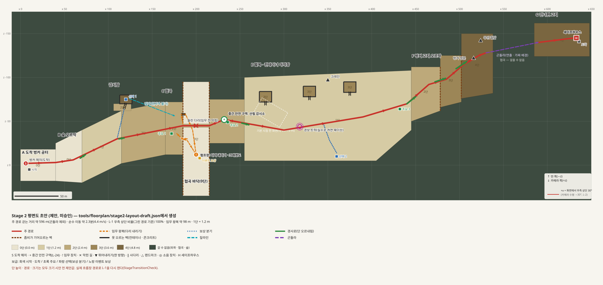
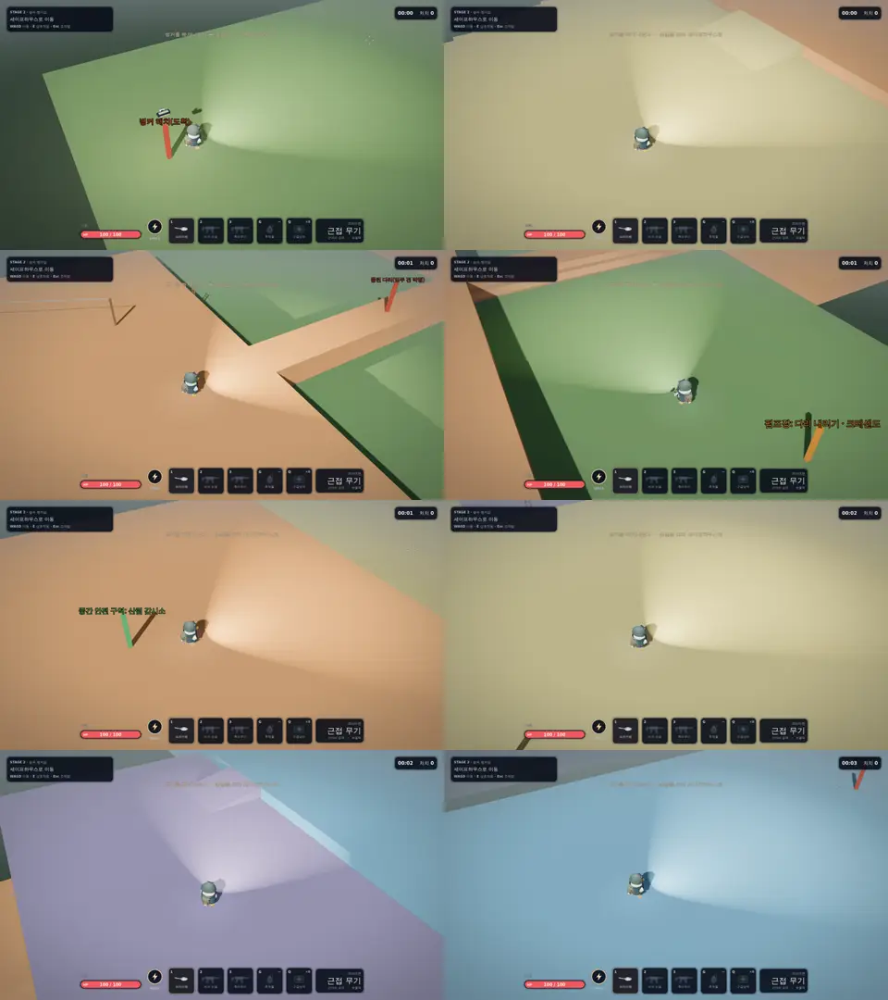

# Stage 2 평면도 초안

> 작성: 2026-10-23. [맵 확장 계획](map-expansion-plan.md) 7.2의 **1단계(전체 평면도)** 결과물이다. **2026-10-23 사용자가 10장의 다섯 가지를 모두 추천안으로 승인했다(L-29, L-3 갱신, T-24 형식).** 수치는 크기 시안의 시작값이다. 게임 코드 · 지형은 아직 바뀌지 않았다.
> 근거 결정: 스테이지 20분(L-19), 첫 시안 Stage 2(L-20), 높이 단 · 연출 이동(L-15~L-18 · L-21), 중간 안전 구역 · 복귀(L-24 · M-32), 임무 왕복 재등장(L-27), Stage 2 테마 유지(L-28), 맵 데이터 파일(T-24), 진행 방향(L-1), 통로 폭(L-9).



그림은 [`game/content/data/stages/stage2_layout.json`](../game/content/data/stages/stage2_layout.json)(2026-10-23 `tools/floorplan/stage2-layout-draft.json`에서 옮김 — 게임이 직접 읽는 맵 데이터, T-24)에서 [`render_floorplan.py`](../tools/floorplan/render_floorplan.py)로 만든다(파이썬 표준 라이브러리만 사용).

```
python tools/floorplan/render_floorplan.py game/content/data/stages/stage2_layout.json doc/images/stage2-floorplan.svg
```

그림 방향: 오른쪽이 월드 +x(화면에서는 우측 상단 30°), 위가 먼 쪽(−z), 아래가 카메라 쪽(+z). 높은 단은 먼 쪽과 진행 방향 쪽에 두고, 카메라 쪽은 낮게 둔다(가림 방지, 높이 단 규격 9장).

## 1. 한눈에

| 구역 | x 범위 | 단 | 역할 | 목표 시간 | 주된 행동 |
|---|---|---|---|---|---|
| A 도착 벙커 공터 | 0 ~ 40 | 0 | Stage 1 해치로 도착, 시작 보급 | 0:00 ~ 1:00 | 정비 |
| B 숲 오르막 | 40 ~ 165 | 0 → 1 → 2 | 넓은 숲(폭 약 50 m)을 오르며 소규모 교전. 보상 분기: **감시탑**(사다리로 4단) → **짚라인**으로 협곡 둑에 바로 복귀 | 1:00 ~ 4:30 | 이동 · 소규모 교전 |
| C 협곡과 다리 | 165 ~ 255 | 2 / 바닥 0 | **다리가 들려 있음** → 협곡으로 뛰어내림 → **펌프장에서 다리 내리기(크레센도)** → 긴 사다리로 복귀(적 재등장) → 다리(폭 4 m 병목) | 4:30 ~ 9:00 | 호드 이벤트 |
| D 중간 안전 구역 | 동쪽 둑 226 ~ 238 | 2 | **산림 감시소**: 작은 건물, 출입구 2곳. 주요 보급 2, 죽은 사람 복귀 지점 | 9:00 ~ 10:30 | 정비 |
| E 벌목 · 컨테이너 야적장 | 255 ~ 445 | 1, 컨테이너 위 3 | 가장 넓은 전투 구역(폭 60 ~ 100 m). 컨테이너 위 고지(사다리), 경보 트럭 함정, 보상 분기: **정비 창고** | 10:30 ~ 15:00 | 이동 · 호드 |
| F 벙커 고지 오르막 | 445 ~ 538 | 2 → 3 → 4 | 지그재그 경사로(폭 6 m). 좀비가 벽을 기어올라 따라옴. 정상에 벙커 정문 · 곤돌라 승강장 | 15:00 ~ 18:00 | 이동 · 압박 |
| 곤돌라 | 530 → 590 | — | 협곡 위를 건너는 **연출**(가짜 배경, 살아 있는 전원 탑승) | 18:00 ~ 18:30 | 연출 |
| G 건너편 고지 | 585 ~ 648 | 4 | 도착 → 세이프하우스 | 18:30 ~ 20:00 | 마무리 · 정비 |

행동별 합계(시나리오 상세 4.2 비율과 비교): 이동 · 소규모 교전 약 10.5분(52%) / 호드 · 이벤트 약 6분(30%) / 정비 · 연출 약 3.5분(18%). 구역 길이는 3~5분마다 공간이 바뀌도록 잡았다.

## 2. 구역별 설계 의도

- **A**: 지금 Stage 2의 벙커 해치 · 모래주머니 · 방벽을 그대로 쓴다. 해치 둘레 8 m 보호(L-11).
- **B**: 단이 진행 방향으로 한 단씩 오른다(턱 1.2 m, 경사로 폭 10 m). 턱은 좀비가 기어오를 수 있어 어디서나 따라온다. 감시탑은 위에서 아래로 쏘기 좋은 자리지만, 오래 머무르면 좀비가 기둥 아래로 몰리고 짚라인으로만 빨리 빠져나갈 수 있다.
- **C**: 이 스테이지의 큰 사건. 다리는 문처럼 공유 상태(멀티 동기화 비트)로 다룬다. 뛰어내리기는 한 방향이라 펌프장에 내려가면 사다리로만 돌아온다. 복귀 사다리는 **다리 북쪽**(펌프장 쪽)에 둔다 — 단 지도는 한 칸에 한 단이라 다리 밑으로는 지나갈 수 없다(2026-10-23 I-111로 옮김). 크레센도 동안 좀비가 양쪽 둑에서 협곡 벽을 기어 내려오고 올라온다. 사다리를 오르는 동안은 맞기만 하므로(L-16) 복귀가 긴장 구간이 된다.
- **D**: "완전히 안전하지 않지만 몹이 잘 오지 않는" 자리. 문을 닫지 않는다. 출입구 두 곳만 지키면 되는 크기다. 4장 수치 참고.
- **E**: 지금 Stage 2의 컨테이너 야적장 자산을 넓혀 쓴다. 컨테이너는 못 오르는 벽이므로 위 단은 **사다리 · 점프 몬스터 · 무장 동물(사다리)**만 올라온다. 고지대 무적 방지를 위해 컨테이너 위에도 leaper가 뛰어오르도록 한다(높이 단 규격 10장). 경보 트럭은 쏘거나 부딪히면 울리는 실수 함정(L-8).
- **F**: 위에서 내려다보며 야적장을 정리하고 오르는 구간. 위에 무장 동물을 두면(무장 테마) 아래에서는 못 쏘므로 사다리 · 엄폐로 접근해야 한다.
- **곤돌라 · G**: 협곡은 실제 맵이 아니라 곤돌라 연출의 가짜 배경이다(L-18). G는 짧게 두고 세이프하우스는 지금 구조(문 · 스위치)를 쓴다.

## 3. 크기

| 항목 | 지금 Stage 2 | 초안 |
|---|---|---|
| 관리 영역 | 118 × 24 m | 약 660 × 215 m |
| 주 경로 걷는 거리 | 약 100 m(해치 x 6 → 세이프하우스 x 106) | **약 600 m**(곤돌라 제외), 순수 이동 약 2.3분(4.4 m/s) |
| 임무 왕복 | 없음 | 약 80 m(뛰어내림 → 펌프장 → 사다리 → 다리, 2026-10-23 복귀 사다리를 다리 북쪽으로 옮긴 뒤 그림 도구 측정 78 m) |
| 보상 분기 | 없음 | 감시탑 약 35 m(짚라인 복귀), 정비 창고 약 35 m 왕복 |
| 전투 구역 폭 | 약 14 ~ 20 m | 40 ~ 100 m(L-9의 주 통로 10~14 m보다 넓은 "구역"), 병목은 다리 4 m · 지그재그 6 m |

20분 중 순수 이동이 2.3분이면 나머지는 교전 · 이벤트 · 정비가 채운다. 이 비율이 맞는지는 **크기 시안(7.2의 3단계)**에서 실제로 걸어 보고 정한다. 화면 크기 감각: 기본 시점 한 화면이 약 34 × 19 m라 E 야적장은 가로 약 5.5화면, 세로 2~3화면이다.

## 4. 중간 안전 구역(D) 제안 수치 `[임시]`

| 항목 | 제안 |
|---|---|
| 크기 | 건물 약 12 × 10 m + 둘레 울타리 마당 |
| 출입구 | 2곳(폭 3 m): 다리 쪽, 야적장 쪽 |
| 미리 배치 금지 | 반경 15 m |
| 웨이브 등장 금지 | 반경 25 m(화면 밖 등장 규칙 L-4는 그대로) |
| 시간 습격 | 생존자가 안에 있는 동안 멈춤, 모두 나오면 다시 시작. 이미 쫓아온 적 · 소리로 깬 적은 들어온다 |
| 보급 | 주요 보급 2(탄약 더미 · 구급상자) |
| 복귀(M-32) | 죽은 사람이 건물 안에서 체력 50 · 1번 칸 기본 보조 무기로 돌아옴 |

## 5. 20분 보급 예산 제안 `[임시]`

시나리오 상세 5.3(12~15분 기준)을 약 1.4배로 늘렸다. 4인 팀 전체 기준.

| 항목 | 12~15분 예산 | 20분 제안 | 초안의 자리 |
|---|---|---|---|
| 시작 정비(예산 밖) | 1곳 | 1곳 | A 해치 옆 |
| 주요 보급 지점 | 2곳 | **3곳** | C 다리 앞 검문소, D 감시소, E 야적장 끝 |
| 선택 탐색 보급 | 1~2곳 | 2곳 | B 감시탑, E 정비 창고 |
| 이벤트 보상 | — | 1곳 | C 펌프장(크레센도 뒤) |
| 새 무기 발견 | 1~2회 | 2~3회, 한 번에 1~2종 | 주요 · 선택 지점 안 |
| 탄약 더미 | 1~2곳 | 2~3곳 | 주요 지점 안에만(크레센도 장치 10 m 안 금지, L-12) |
| 구급상자 | 팀 2~4 | 팀 3~5 | |
| 투척물 | 팀 2~4 | 팀 3~5 | |
| 중화기 | 0~1 | 0~1 | 펌프장 이벤트 보상 |
| 도착 | 다음 스테이지 예산 | 같음 | G 세이프하우스 |

## 6. 시간 습격 간격 제안 `[임시]`

지금 디렉터는 첫 습격 30~45초 뒤, 이후 45~70초마다 무리 · 30~45초마다 특수 몬스터를 보낸다(시나리오 상세 9.2). 20분이면 무리만 약 20회가 되어 쌓임 → 정점 → 휴식 흐름이 없어진다.

- 시간 습격은 **이동 구역(B · E · F)에서만**, 무리 간격 **90~120초**(약 8~10회), 특수 몬스터 60~90초.
- 멈춤: 시작 60초, 중간 안전 구역 안(4장), 크레센도가 끝난 뒤 45초, 곤돌라 · G.
- 압박이 높을 때 미루는 지금 규칙(강도 0.7 초과 · 체력 25 미만이면 10초)은 유지.

## 7. L-1 측정 범위 제안

- **분모는 주 경로만**: 도착 해치 → 임무 시작점 → 다리 → 중간 안전 구역 → 야적장 → 고지 → 곤돌라 승강장, 곤돌라 도착 → 세이프하우스.
- **임무 왕복 · 보상 분기 · 곤돌라 구간은 제외**하고 길이만 따로 기록한다(L-3의 "선택형 탐색 · 전투 후퇴 제외"를 같은 방식으로 넓힘).
- 초안의 그린 주 경로는 모든 구간이 15~75° 안이라 100%다. 실제 흐름장 경로는 구불어지므로 크기 시안에서 `StageTransitionCheck` 방식으로 다시 잰다.
- 평면도 기준으로는 진행 방향을 **먼 쪽으로 최대 45°, 카메라 쪽으로 최대 15°**까지 기울일 수 있다(카메라 수평 −30°에서 15~75°에 해당).

## 8. 맵 데이터 형식 초안 (T-24의 B)

초안 JSON이 첫 형식 시험이다. 2026-10-23부터 게임이 읽어 크기 시안을 짓는다(11장). 최상위 항목:

| 키 | 내용 | 게임에서 쓸 곳 |
|---|---|---|
| `bounds` | 관리 영역 [x0, z0, x1, z1] | `StageMap.Area`, 흐름장 크기, 카메라 경계 |
| `tier_height_m` | 1단 높이(1.2) | 높이 단 |
| `regions` | 다각형 + 단 + 이름(뒤의 것이 앞을 덮음) | 단 지도, 걸을 수 있는 바닥, 바닥 칠하기 |
| `edges` | 선 + 종류 + `climbable` | 보이지 않는 벽 · 외곽 채우기(A-23) · 기어오르기 |
| `links` | `ramp` · `ladder` · `drop` · `zipline` · `gondola` (from → to) | 흐름장 연결, 연출 이동 |
| `routes` | 주 경로 · 임무 · 보상 분기 | L-1 측정, 검사 |
| `markers` | 시작 · 막힌 길 · 임무 장치 · 중간 안전 구역 · 소음 장치 · 랜드마크 · 세이프하우스 | `StageMap`의 시작점 · 문 · 경보 장치 · 목표 |
| `supplies` | 보급 지점 종류 · 위치 | 지금의 `stages/stage2_supplies.json`으로 옮김(L-12 형식 유지) |

조우(`stage2_encounters.json`) · 보급은 지금처럼 별도 파일에 두고 `markers`의 이름으로 연결하는 방향을 추천한다. 소품 배치(`props`)는 마감 단계(7.2의 7단계)에서 추가한다. 에디터 장면(C)으로 옮길 때도 같은 데이터로 내보내게 한다.

## 9. 기술 위험과 확인할 것

- **흐름장 크기**: 관리 영역이 지금의 약 50배(1 m 칸 약 14만 칸)이고 이동 유형마다 흐름장이 하나씩 필요하다(높이 단 규격 5.4). 구역 단위 계산(L-7처럼 앞 구역만) 또는 큰 칸 · 계층 방식을 크기 시안에서 측정해 정한다. 2026-10-23 측정: 한 번에 20~53 ms로 너무 느림(11장, I-109).
- **검사 계약**: Stage 2를 갈아엎으므로 `StageTransitionCheck`의 Stage 2 항목과 `EnvironmentReview`의 Stage 2 월드 · 흐름장 해시가 바뀐다. 의도된 변경으로 검토하고 기준을 갱신한다(맵 확장 계획 6장: 무조건 재생성하지 않음).
- **자산 재사용**: 벙커 해치 · 방벽 · 모래주머니(A), 개울 다리 → 협곡 다리(C), 컨테이너 야적장 · 창고(E), 세이프하우스(G), 숲 · 암반 외곽(A-23)을 옮겨 쓴다.
- **모드 영향**: 생존(거점)은 Stage 1 지형을 쓰고 시나리오와 지리를 공유하지 않으므로(L-26) 영향이 없다. 난전 들판도 별개.
- **멀티**: 다리(문과 같은 공유 비트), 곤돌라 탑승 판정, 중간 안전 구역 복귀를 방장이 판정.
- **단 시스템 선행**: 이 초안의 단차를 실제로 지으려면 7.2의 2단계(단 시스템 핵심)가 먼저 필요하다.

## 10. 확인받을 것 — 2026-10-23 모두 추천안으로 확정

구역 흐름 · 크기 · 시작 수치 · L-1 범위(주 경로만) · 데이터 형식, 그리고 새 시안을 별도 맵으로 먼저 짓고 확정 뒤 Stage 2를 교체하는 것까지 확정(L-29).

1. 구역 흐름(A → G)과 장소 구성: 감시탑 · 짚라인, 협곡 다리 임무(펌프장 크레센도), 산림 감시소(중간 안전 구역), 야적장 경보 트럭 · 정비 창고, 벙커 고지 · 곤돌라.
2. 크기: 주 경로 약 600 m, 전투 구역 폭 40~100 m.
3. 4~6장 수치(중간 안전 구역 · 보급 · 시간 습격)를 크기 시안의 시작값으로 써도 되는지.
4. 7장 L-1 측정 범위.
5. 8장 데이터 형식으로 크기 시안을 짓는 것.

## 11. 크기 시안 결과 — 2026-10-23 (맵 확장 계획 7.2의 3단계)

이 문서의 JSON을 게임이 직접 읽어 그레이박스 맵을 짓는다(T-24의 B). **지금 Stage 2는 그대로이고 시안은 별도 맵**이다(L-29: 확정 뒤 교체). 아직 메뉴 · 시나리오 진행에 연결하지 않았다.



구역 8곳을 기본 카메라로 찍은 그림(`SizeDraftCapture`, 호환 렌더러). 색은 단별(초록 0단 → 모래 1 → 흙 2 → 보라 3 → 파랑 4), 기둥은 표식(빨강 시작 · 막힌 길 · 세이프하우스, 초록 중간 안전 구역, 주황 임무, 보라 소음 장치). 크기 확인용 상자이며 최종 외형이 아니다(7단계 마감은 새 모델이 필요해 로컬 작업).

| 항목 | 내용 | 코드 |
|---|---|---|
| 데이터 | `game/content/data/stages/stage2_layout.json`(이 문서 8장 형식, 버전 1). 읽기 오류는 경고로 모으고 짓기는 계속 | `StageLayout.cs` |
| 바닥 | 1 m 칸마다 마지막으로 덮은 구역의 단을 찍고, 같은 단끼리 큰 직사각형으로 합쳐 단 높이 상자로 지음. 구역 밖은 보이지 않는 8 m 벽 + 어두운 바닥 | `LayoutMap.BuildMap`, `MergeRects` |
| 연결 | `ramp`(6 m 쐐기, 칸 경계에 맞춤) · `ladder` · `drop` · `zipline` · `gondola`(생존자 흐름장에 탈것으로 연결). 오를 수 있는 가장자리(`climbable`)는 벽 오르기 칸 | `LayoutMap.BuildLink` |
| 표식 | `markers`마다 색 기둥 + 이름 | `LayoutMap.Post` |

**측정**(`SizeDraftCheck` 28개 통과, Linux 클라우드 헤드리스 `--fixed-fps 60`, 몬스터 없음):

| 측정 | 값 | 판단 |
|---|---|---|
| 짓는 시간 | 약 3.1~3.4초, 바닥 상자 149 · 막는 상자 168, 칸 660 × 215 = 141,900 | 로딩 화면 안에서 허용 가능. 단 계산은 매 실행 반복하므로 C(에디터 장면)로 옮기면 줄어듦 |
| 주 경로 | 걷는 길 620 m(평면도 목표 약 600 m), 순수 걷기 2.3분(4.4 m/s), 탈것 1번(곤돌라 61 m) | 크기는 계획대로. 20분(L-19) 중 약 2.3분이 이동이라 나머지는 조우 · 임무 · 방어 몫 |
| L-1 비율 | 주 경로 칸 경로 기준 100%(몸 폭 · 실제 조작 전) | L-1(70%) 충족. 실제 플레이 경로로 다시 재야 함 |
| 걸어서 끝까지 | 시작 해치 → 세이프하우스 2.6분, 끼임 없음, 곤돌라 1번(사다리 · 짚라인은 주 경로에 없어 0번 — 분기용) | 경사로 · 다리 · 곤돌라 연결이 끊긴 곳 없음 |
| 흐름장 다시 계산 | 이동 유형별 한 번에 약 20~53 ms(사다리 35 · 벽 53 · 점프 26 · 비행 20 ms, 실행마다 차이) | **너무 느림(I-109)**: 네 유형이 한 프레임에 겹치면 100 ms 이상 멈칫. 구역 단위 · 계층 방식이 필요 |

**시안에서 고친 것**(I-110): 대각선 한 칸이 낮은 단 모서리를 가로질러 다리 끝에서 협곡으로 떨어지던 문제, 경사로 옆 칸이 칸 경계와 어긋나 걷는 사람이 절벽에 걸리던 문제.

**다음**: 5단계(배치)는 12장. 사용자 시각 검수(넓게 느껴지는지 · 이동 피로)는 실제 플레이로 따로 확인해야 한다.

## 12. 배치 1차 — 2026-10-23 (맵 확장 계획 7.2의 5단계)

크기 시안에 조우 · 보급 · 임무 · 중간 안전 구역 · 세이프하우스를 넣어 **처음부터 끝까지 한 판이 되게** 했다. 수치는 모두 4~6장의 `[임시]` 시작값이고, 실제 플레이로 맞춰야 한다.

| 항목 | 내용 | 데이터 / 코드 |
|---|---|---|
| 조우 | 구역 7개(A~G를 x로 나눔, 들어간 구역의 다음 구역을 채움). 미리 배치 무리 약 95마리(혼자면 인원 보정으로 줄어듦) + 이름 있는 특수 3, 숨은 등장 지점 49곳(모든 단 — 감시탑 기둥 옆, 컨테이너 위, 고지 단마다). 해치 8 m 보호 | `stage2_draft_encounters.json` |
| 중간 안전 구역(D) | 감시소 오두막 12 × 10 m, 양 끝 출입구 3 m(다리 쪽 · 야적장 쪽), 문 없음. 미리 배치 금지 15 m · 웨이브 금지 25 m · 사람이 8 m 안에 있으면 시간 습격 멈춤. 주요 보급 2 | `safe_zones`, `LayoutMap.BuildHut`, `HordeDirector.IsProtected` · `RaidsHeld` |
| 시간 습격 | 이동 구역(B 숲 · E 야적장 · F 고지)에서만, 무리 90~120초 · 특수 60~90초, 시작 60초 · 크레센도 뒤 45초 멈춤, 압박 높을 때 미루기는 그대로 | `raids`, `HordeDirector.TickRaids` |
| 다리 임무(C) | 다리 가운데에 들린 다리 판(문)이 서 있어 건널 수 없음 → 서쪽 둑에서 뛰어내려 펌프 켜기(E) → 크레센도 50초 → 판이 내려가며 다리가 열림. Stage 1 셔터와 같은 문 · 패널 · 목표 단계를 써서 멀티 동기화 비트 · 버티기 타이머가 그대로. 목표 · 안내 문구는 맵별 키 | `LayoutMap.BuildBridgeMission`, `StageMap.Crescendo*Key` |
| 돌아오는 길 재등장(L-27) | 크레센도가 끝나 다리가 열릴 때 서쪽 둑 사다리 위 · 다리 앞에 무리 2개(경계 6 · 잠복 3)를 화면 밖 우선으로 배치 | `after: "mission"`, `HordeDirector.FillAfterMission` |
| 보급 | 시작 1 · 주요 3(다리 앞 검문소 · 감시소 · 야적장 끝) · 선택 2(감시탑 · 정비 창고) · 이벤트 1(펌프장 M249) · 도착 1. 구급상자 4 · 투척물 5 · 길에서 찾는 무기 2 · 탄약 더미 3(주요 지점만, 펌프 10 m 밖). 물건은 선 단의 바닥에 놓임 | `stage2_draft_supplies.json`, `StageMap.PlaceSupplies` |
| 세이프하우스(G) | 14 × 12 m 방, 서쪽 문, 안에 들어가면 문 닫기 스위치 → 클리어(다음 스테이지 연결은 아직 없음) | `LayoutMap.BuildSafehouse` |

**측정 · 검사**(`SizeDraftCheck` 72개 통과, Linux 클라우드 헤드리스 `--fixed-fps 60`):

- 모든 구역을 채우면 혼자 기준 약 70마리가 미리 서 있고, 안전 구역 15 m 안에는 0. 안전 구역에 서 있을 때 웨이브 등장 지점 60번 고르기 중 25 m 안 0번.
- 0단보다 높은 구역 14곳 모두 몬스터(사다리 · 벽 · 점프)가 경로에서 올라올 수 있음. G(곤돌라 건너편)는 경로와 끊긴 섬이라 자체 등장 지점 2곳으로 확인.
- 다리가 들린 동안은 세이프하우스에 갈 수 없음 → 서쪽 둑에서 뛰어내려 펌프까지 8초 → 크레센도 → 다리 열림 · 돌아오는 길에 10마리 → 펌프에서 사다리 · 다리를 건너 감시소까지 22초(몬스터 없이).
- 해치에서 세이프하우스까지 2.6분(몬스터 없이) → 문 닫기 → 클리어.

**아직 아닌 것**: 실제 플레이(전투가 들어간 시간 · 난이도 · 20분이 맞는지), 죽은 사람이 안전 구역에서 돌아오기(M-32), 다리 판 · 펌프 · 오두막 · 세이프하우스 모델(지금은 상자, 로컬 Codex 작업 — 지시문 [`model-briefs/stage2-landmarks.md`](model-briefs/stage2-landmarks.md) 준비됨, 실행 전), 메뉴 · 시나리오 진행 연결(L-29: 확정 뒤 Stage 2 교체), 경보 트럭(E의 소음 장치), 멀티 2PC 확인.
