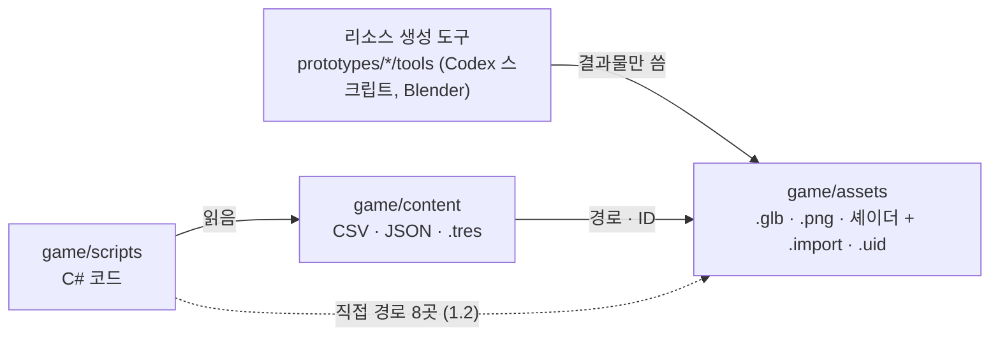

# 작업 방식: 동시 작업과 두 PC

작성일: 2026-10-26. 2026-10-26 구조 점검을 바탕으로, 코드 작업과 리소스 작업이 같은 PC에서 동시에 돌거나 PC 두 대에서 나뉘어 돌 때 지킬 규칙이다. 결정 기록은 [decisions.md](decisions.md) T-26, 저장소 공통 규칙은 [AGENTS.md](../AGENTS.md).

- **규칙**(2장 · 3장)은 지금부터 따른다.
- **개선 후보**(5장)는 아직 하지 않은 제안이다.

---

## 1. 지금 구조 (2026-10-26 점검)

### 1.1 연결은 느슨하고, 필요할 때만 불러온다

- 코드는 주로 **데이터**를 읽는다. 데이터 로더가 `res://content/data/...`를 직접 부르는 곳이 33곳 있고, 모델 · 아이콘 경로는 데이터 안에 있다. 예: 무기 모델은 `weapons.csv`의 `model` 칸, 캐릭터 · 적 모양은 `content/characters` · `content/enemies`의 `.tres`.
- **필요할 때 불러온다.** 장면 파일(`scenes/Stage1.tscn` · `Menu.tscn`)은 스크립트 하나만 건다. 모델 · 이펙트는 실행 중 처음 쓰일 때 `GD.Load` · `ResourceLoader` · `ContentCache`로 불러온다.
- **소품은 폴더 목록으로 읽는다.** `PropLibrary`가 키트 폴더의 `manifest.json`을 읽으므로, 소품을 추가할 때 코드를 고치지 않는다.
- **리소스 제작은 분리되어 있다.** 생성 스크립트가 `game/assets`에 결과물만 쓰고, 게임은 그 파일을 경로로만 안다. Codex는 별도 작업 폴더(`git worktree`)에서 작업한다.

### 1.2 코드에 리소스 경로가 직접 적힌 곳 (8파일) → 2026-10-26 목록 파일로 옮김

| 파일 | 경로 |
|---|---|
| `Cards/CardCatalog.cs` | `assets/icons/cards/card_{이름}.png` (이름 규칙) |
| `Cards/CardProps.cs` | `assets/card-props/` 모델 3개 |
| `Cards/TeamCardView.cs` | `assets/effects/cards/` 폴더 |
| `Companions/DroneModel.cs` · `Pets/PetModel.cs` | `assets/drones/{id}.glb` · `assets/pets/{id}.glb` (이름 규칙) |
| `UI/VoteWindow.cs` | `assets/icons/ui/` 투표 이미지 2개 |
| `World/PropLibrary.cs` | 키트 폴더 5개 목록 |
| `World/StageArt.cs` | `assets/environment/` 바닥 · 벽 셰이더 |

**2026-10-26 개선 ②로 옮김**: 위 경로는 이제 [`game/content/data/asset_paths.json`](../game/content/data/asset_paths.json)에 있다. 종류는 `files`(파일 하나) · `patterns`(`{0}`에 카드 이름 · 모델 ID) · `folders`(키트 폴더) 셋이고, 코드는 `AssetPaths.File` · `Pattern` · `Folders`로 읽는다. 리소스를 옮기거나 이름을 바꾸면 이 목록만 고친다. (같은 날 `codex/mammal-weapon-arms`를 병합하며 `AssetPathsCheck`가 잡은 사자 팔 마디 모델 경로 `character.mammal_arm_segments`도 목록으로 옮김.) `AssetPathsCheck`가 목록의 모든 경로가 실제로 있는지와, `scripts/`의 C# 소스에 `"res://assets` 직접 경로가 다시 생기지 않았는지 확인한다. 나머지 리소스는 원래대로 각 데이터(CSV · JSON · `.tres`)만 고치면 된다.

### 1.3 여럿이 함께 고치는 파일 (지난 7일, 커밋 114개 기준)

| 파일 | 바뀐 횟수 | 성격 |
|---|---|---|
| `doc/issues.md` | 103 | 모든 작업이 기록 |
| `doc/decisions.md` | 98 | 모든 작업이 기록 |
| `doc/feature-checklist.md` | 88 | 모든 작업이 기록 |
| `game/scripts/World/Stage.cs` (1266줄) | 27 | 스테이지 중심 코드 |
| `game/scripts/Enemies/Enemy.cs` | 27 | |
| `game/scripts/Weapons/WeaponController.cs` | 23 | |
| `game/scripts/Player/Player.cs` | 22 | |
| `game/content/lan/{kor,eng}/ui.csv` | 22 | 언어 문장 |
| `game/scripts/UI/Hud.cs` · `Net/StageNet.cs` | 19 | |

---

## 2. 규칙: 같은 PC에서 동시에 작업할 때

1. **동시에 도는 작업은 각자 작업 폴더(`git worktree`)에서 한다.**
   - 같은 폴더에서 두 작업이 Godot 가져오기(`--import`) · `dotnet build` · 검사 · Studio를 동시에 돌리면, 같은 `.godot/` 캐시와 빌드 결과를 같이 쓰게 된다. 그러면 파일 잠금으로 빌드가 실패하거나, 예전 DLL로 검사가 돈다.
   - worktree마다 `.godot/`이 따로 생기므로 이 충돌이 없다. Codex 리소스 작업은 이미 이렇게 한다(`C:/Users/psmto/.codex/worktrees/...`).
2. **같은 폴더를 함께 쓸 수밖에 없으면, Godot 가져오기 · 빌드 · 검사는 한 번에 하나만 돌린다.** 리소스를 새로 넣었으면 가져오기를 먼저 끝낸 뒤 코드 쪽이 빌드한다.
3. **커밋은 자기 파일만.** 다른 작업의 커밋 안 된 변경이 같은 파일에 섞여 있으면, 내 부분만 골라 올리거나 그 작업과 순서를 맞춘다. 실제로 `656e2db`에서 조준 작업과 상태이상 작업이 한 커밋에 섞였다.
4. **리소스 작업은 연결 단계에서만 코드를 만진다.** 모델 · 텍스처를 교체하는 동안에는 1.3의 파일을 건드리지 않는다. 게임에 붙이는 단계(새 경로 · 데이터 칸 · 1.2의 파일)는 코드 작업과 겹치지 않는 때에 한 번에 한다.
5. **기록 문서(1.3의 위 세 개)는 내 항목만 고친다.** 다른 작업의 줄을 고치거나 옮기지 않는다. 같은 표의 같은 줄을 동시에 고치지 않도록, 새 내용은 새 줄로 추가한다.

## 3. 규칙: PC 두 대에서 나눠 작업할 때

1. **텍스트(코드 · CSV · JSON · 문서)는 git으로 합친다.** 작업을 시작할 때와 커밋하기 전에 최신 main을 받는다(pull). 1.3의 파일은 짧게 고치고 빨리 올린다.
2. **모델 · 이미지 · 소리(.glb · .png · .wav · .blend)는 합쳐지지 않는다.** 한 리소스는 한 PC(한 담당)만 고친다. 양쪽이 같은 파일을 고치면 한쪽을 버려야 한다.
3. **`.import` · `.uid`는 리소스를 만든 PC가 함께 커밋하고, 다른 PC는 받아서 쓴다.**
   - Godot은 새 파일을 처음 가져올 때 PC마다 다른 ID(`uid://...`)를 만든다. 두 PC가 같은 새 파일을 각자 가져오면 ID가 엇갈려 참조가 깨질 수 있다.
   - 지금 버전 관리 중: `.import` 221개, `.uid` 372개.
   - 받은 쪽에서 가져오기를 다시 돌리는 것은 괜찮다. 단, 받은 `.import` · `.uid`를 새로 만든 것으로 덮어 올리지 않는다.
4. **`.godot/` · `bin/` · `obj/` · `output/`은 PC마다 따로다.** 커밋하지 않는다(이미 `.gitignore`).
5. **검사 결과는 PC마다 다시 확인한다.** 한 PC에서 통과했어도, 받은 쪽에서 가져오기 → 빌드 → 관련 검사를 다시 돌린 뒤 이어서 작업한다.

## 4. 저장소 크기

- 2026-10-26 기준: `.git` 134 MB. `prototypes/`에 추적 중인 바이너리 135개(88 MB), `game/assets`에 195개.
- 지금은 괜찮다. 두 PC로 오래 쓰면서 모델 · `.blend`가 자주 바뀌면, 받는 시간과 용량이 늘어난다. 그때 Git LFS(큰 바이너리를 따로 보관)를 검토한다(5장 ⑤).

---

## 5. 개선 후보 (제안, 아직 안 함)

| | 내용 | 기대 효과 | 비용 |
|---|---|---|---|
| ① | 기록 문서 3개 나누기: 기능별 폴더 + 작업 하나에 기록 파일 하나 + 짧은 색인. **설계안: [기록 문서 나누기](records-split-plan.md)**(2026-10-26, 아직 안 옮김) | 가장 많이 겹치는 곳의 충돌 · 섞인 커밋이 가장 크게 줆 | 문서 구조 이동, 링크 정리 |
| ② | ~~1.2의 직접 경로 8곳을 데이터(목록 파일)로 옮기기~~ **완료 2026-10-26** (`asset_paths.json`, `AssetPathsCheck`) | 아트 쪽 파일 이름 변경에 코드 수정이 필요 없음 | 작음 |
| ③ | `Stage.cs` 등 큰 파일을 책임별로 더 나누기(지금도 `StageArt` · `StageMap` · `StageCommonRoster`처럼 일부는 나뉘어 있음) | 코드 작업끼리 겹침이 줆 | 중간, 동작 변경 없이 옮겨야 함 |
| ④ | 언어 파일 `ui.csv`를 기능별로 나누기(`card.csv`처럼) | 언어 문장 추가끼리 겹침이 줆 | 작음 |
| ⑤ | Git LFS 도입 | 두 PC에서 받는 크기 · 시간이 줆 | 설정 · 기존 이력 이전 |

## 6. 점검 근거

- 연결: `game/scripts`의 `res://` 문자열 집계, 장면 파일의 `ext_resource`, `GD.Load` 28 · `ResourceLoader` 18 · `ContentCache.Load` 4.
- 함께 고치는 파일: `git log --since="7 days ago" --name-only`.
- 크기 · 설정: `.gitattributes`(바이너리 표시, LFS 없음), `.gitignore`, `git worktree list`.
